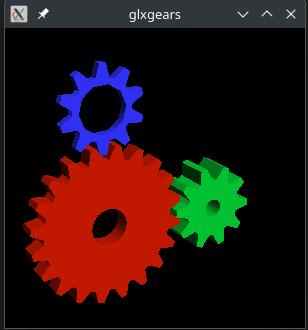
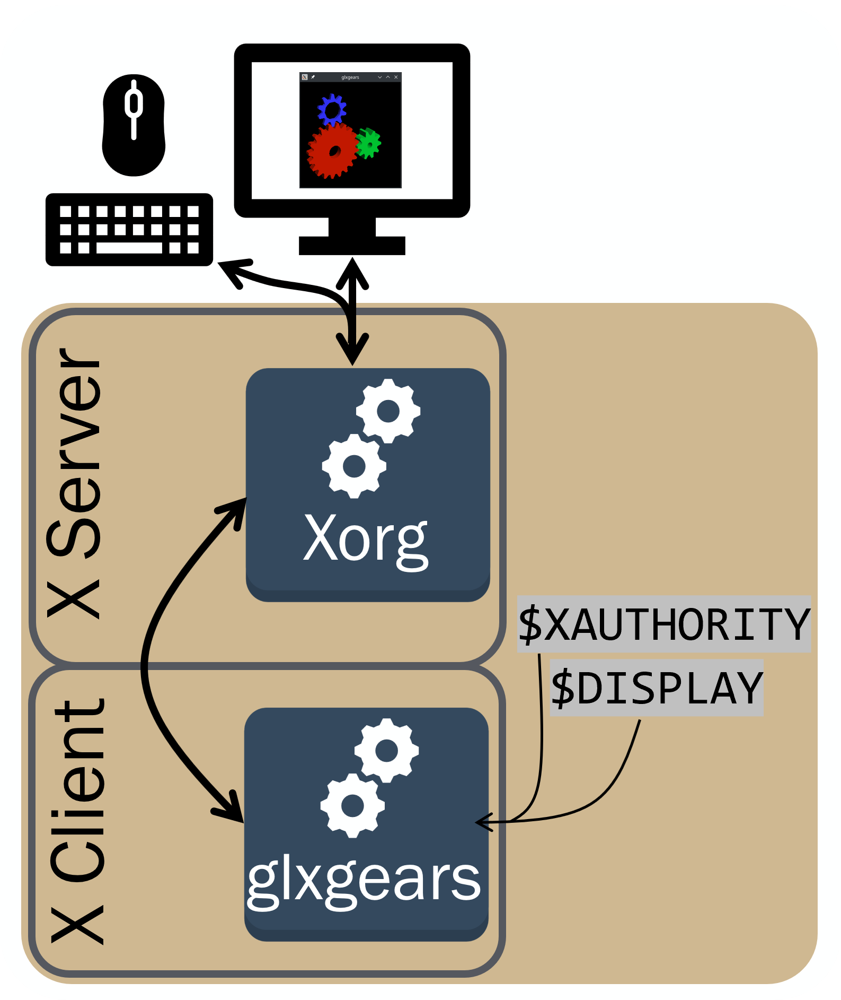
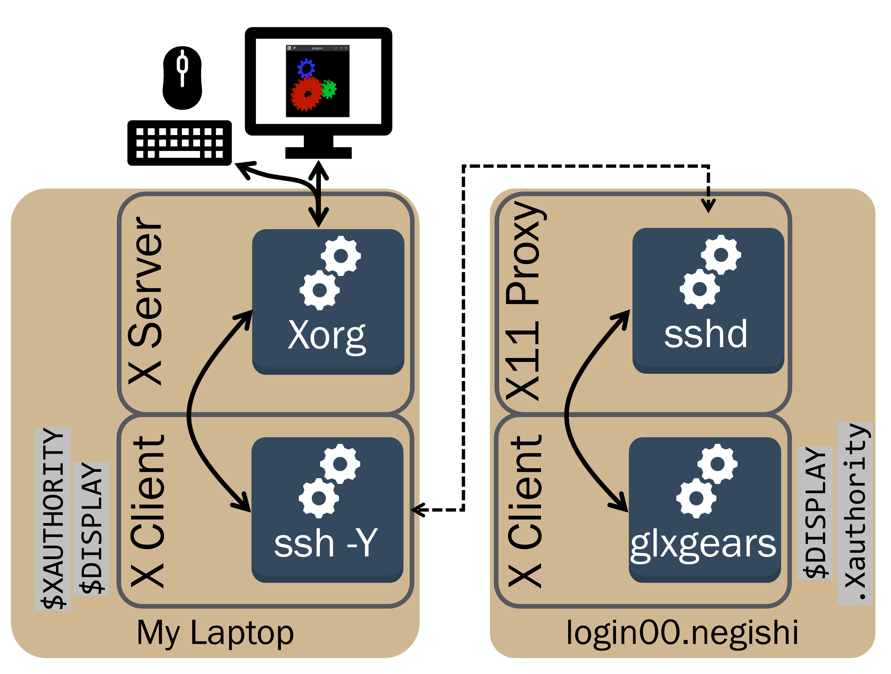
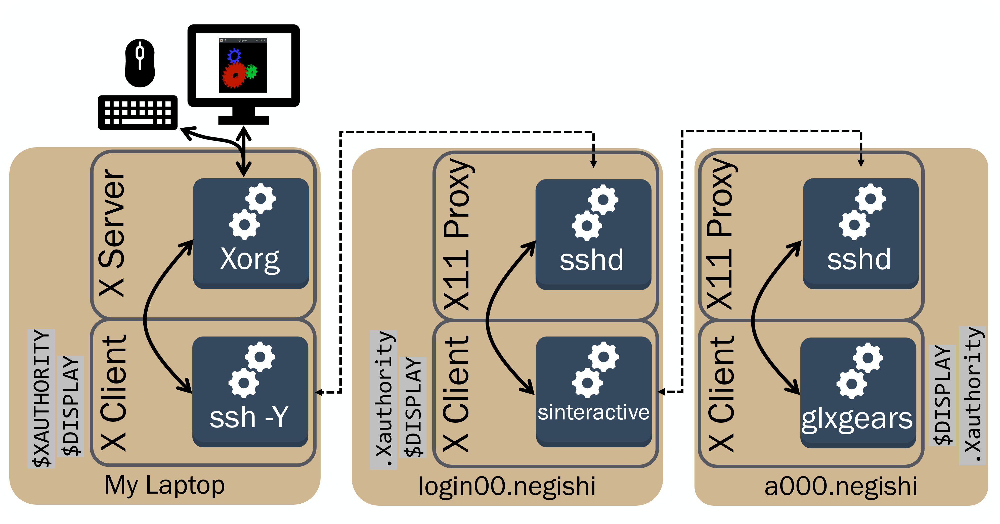
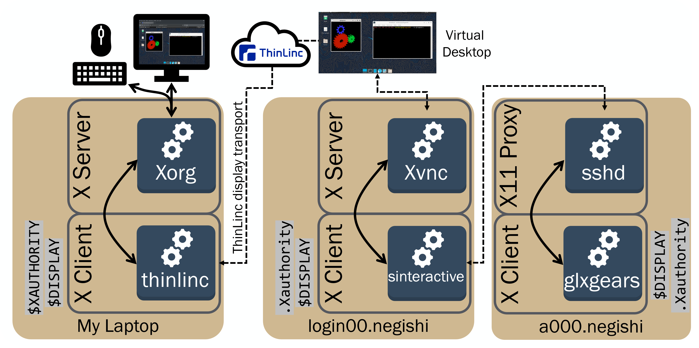
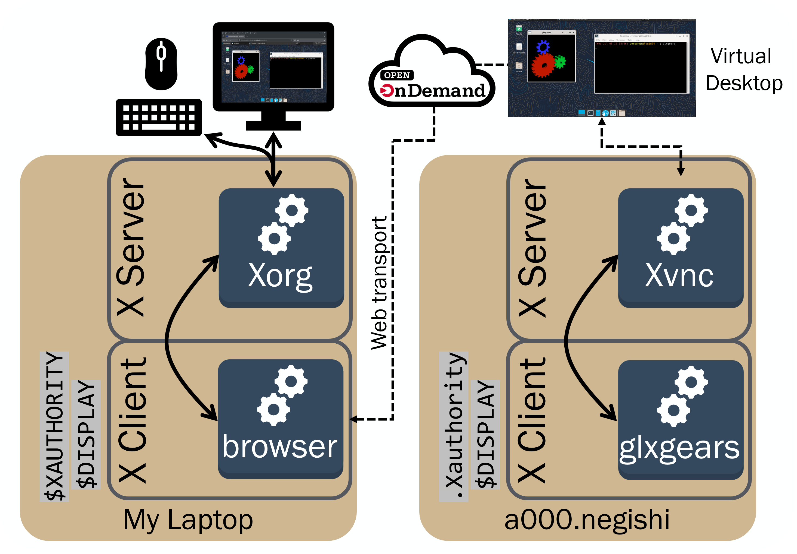

---
date:
  created: 2026-11-11

tags:
  - ssh
  - X11
  - graphics
  - thinlinc

authors:
  - verburgt
---

# Display Systems in a Distributed Environment

Displays are an indispensable portion of many workflows, as many programs are only accessible through Graphical User Interfaces (GUIs). Unfortunately, RCAC’s computing clusters don’t have any monitors plugged into them, so getting a remote display is going to require a few extra steps. This post will cover the details and best practices for using GUI interfaces on RCAC Systems.

<!-- more -->

Many Linux systems, including RCAC clusters, largely use the X windowing system, which originated back in the 1980s. The X windowing system can be broken into two main portions:

* X Client – The program that makes requests to the server to draw
* X Display Server – Receives requests and draws windows to the screen.

We'll break down how X clients and servers can function on remote systems like RCAC clusters, as well as alternative methods for using GUI programs.

## Client and Server Setup

### X Server
The X server is typically a process owned by root that is launched at startup. On most Linux systems, the X server will be Xorg. You can see it running in the process tree:
```text linenums="0"
myuser@mylaptop:~$ pstree
systemd─┬─ModemManager───3*[{ModemManager}]
        …
        ├─ibus-x11───5*[{ibus-x11}]
        └─sddm─┬─Xorg───5*[{Xorg}]
               ├─sddm-helper───startplasma-x11─┬─ssh-agent
               │                               └─{startplasma-x11}
               └─{sddm}

```
### X Client
An X client is any process that wants to make requests to an X server. Typically, programs won't make these requests themselves, but will use existing libraries like `xlib` or `xcb` that have been throughly tested.

Let’s start with a simple example of the X Display system on our local Linux computer ( if you don’t have a Linux computer, you can follow along with a virtual desktop at [https://desktop.negishi.rcac.purdue.edu/](https://desktop.negishi.rcac.purdue.edu/ ). Open a terminal and run the `glxgears` command. This should launch a small window of three 3D gears turning!




Taking a closer look at the libraries that `glxgears` links to, we can see that the glxgears program links to the `libxcb` library (really it links to `libGLX`, which links to `LibX11`, which links to `libxcb`).

``` text linenums="0"
myuser@mylaptop:~$ ldd $(which glxgears)
        libX11.so.6 => /lib/x86_64-linux-gnu/libX11.so.6 (0x000072f464087000)
        …
        libGLX.so.0 => /lib/x86_64-linux-gnu/libGLX.so.0 (0x000072f463eb1000)
        libxcb.so.1 => /lib/x86_64-linux-gnu/libxcb.so.1 (0x000072f463e88000)
        …
```

So what's actually happening here? `glxgears` establishes a connection to the X server that was running on your computer with that `xcb` library. Once that connection is established, it can send requests for a new window, and can draw to that window.

The X server can also send data back to the client! Events like changing the window size, mouse clicks, and key presses may need to be transferred back to the client program to take action on.

But, how does the X client even know where to make requests? It looks at your `$DISPLAY`!

### `$DISPLAY` variable

There's a special system variable named `$DISPLAY` that is necessary for the X client to know where to connect to the X server. This is usually just pointing to a socket on the current computer.

You can check that this variable is set to with the `echo $DISPLAY` command. If you're running on your own laptop, you may see it set to something like `:0`:

```bash  linenums="0"
echo $DISPLAY
:0
```

Which is really just telling the client that the X server is listening ona socket like `/tmp/.X11-unix/X0`.

If you are running on thinlinc, or remotely, you may see something like:

```bash linenums="0"
echo $DISPLAY 
:4.0
```

The generalized layout of the `$DISPLAY` variable looks like this:
<span class="perm-type">hostname</span>:<span class="perm-user">displaynumber</span>.<span class="perm-other">screennumber</span>

The <span class="perm-type">hostname</span> is specifying the name of the computer that you are attempting to connect to. If it's empty (as it usually is), unix/0, localhost, it's assumed that the host is just your computer. 

The <span class="perm-user">displaynumber</span> tells you what display you are trying to connect to. If you're running on your local computer, this is almost certainly zero. But if you are running on an RCAC virtual desktop, there might be several different virtual displays connected, so you might have a non-zero number here.

The <span class="perm-other">screennumber</span> is also usually 0, and defaults to zero if not set. It's important to note that on modern linux systems, multiple monitors being attached to your computer are still seen as 1 screen!

If the `$DISPLAY` variable is not set, your GUI programs won't have any idea where to draw to, so checking that `$DISPLAY` has been set is a common first step when troubleshooting display issues. To demonstrate this, let's unset the `$DISPLAY` and try re-running that `glxgears` program:

```text linenums="0"
myuser@mylaptop:~$ unset DISPLAY 
myuser@mylaptop:~$ glxgears
Error: couldn't open display (null)
```

Since the `$DISPLAY` variable isn't set, our X client can't find and connect to our X display server!

### Xauthority

Since X can transfer things like clicks and key presses, it's important to have some level of authentication. 

The client needs to have access to authentication that the X client will accept. For that, it looks at your `Xauthority` file, which is specified either by the `$XAUTHORITY` variable, or the `.Xauthority` file in your home directory.

The Xauthority file contains a list of "cookies" that are associated with a specific host and display number. You can see these with the `xauth list` command!

``` linenums="0"
myuser@mylaptop:~$ xauth list
mylaptop/unix:0  MIT-MAGIC-COOKIE-1  a1b2c3d4e5f60718293a4b5c6d7e8f90
```
The first piece of information contains the host and display that this cookie is for, in this case, it's the `mylaptop` host and display `0`. The next is the authentication method, which is typically `MIT-MAGIC-COOKIE`, and the last is the cookie itself. These cookies are typically generated and placed in the `$XAUTHORITY`by the X server itself.

When establishing a connection to the X server, the X client looks through your Xauthority and sends the correct cookie for the host and display it is trying to connect to.


!!! note "Authorized Users"

      Sometimes you are still able to connect to a local X server even if the client can't find a valid cookie. This is because some users are authorized to run without verification locally. Check the `xhost` command to see if you're an authorized user!
      ``` linenums="0"
      myuser@mylaptop:~$ xhost 
      access control enabled, only authorized clients can connect
      SI:localuser:myuser
      ``` 


You may have noticed the names "server" and "client" as well as the <span class="perm-type">hostname</span> in our `$DISPLAY` might imply that this display server has some networking capabilities. This is because it's entirely possible for the X server and X Client to be on different computers! 

Back in the day, this would have been handled by setting you `$DISPLAY` on one computer to point to an X server socket on another. For example, you could have set 

```bash linenums="0"
export DISPLAY=192.168.10.0:0
```
Where `192.168.10.0` is the IP address of the machine running the X server, and the display is zero.

However, this isn't a very easy or secure way of using remote displays, and nowadays we usually let other programs (like SSH) handle the actual forwarding for us (more on this below!). 


### Putting it all together

1) The X client reads your `$DISPLAY` to find the hostname and display to connect to. 

2) The X client reads your `$XAUTHORITY` to find the authentication credentials for the X server.

3) The X client reaches out to the X server, and provides the credentials to connect.

4) Once a connection is established, the client can make requests to the server, such as creating a window.

5) The X server draws to the display, and can send events back to the X client.




## Remote Clients over SSH X-Forwarding

One of the nice things about the X windowing system is the fact that the client doesn't need to be running on the same computer as the server. Let's try logging onto the cluster via SSH and starting an X client there.

```text linenums="0"
myuser@mylaptop:~$ ssh username@negishi.rcac.purdue.edu
username@login01:~$ glxgears
Error: couldn't open display (null)
```

Wait, Why didn't that work? Let's check if our `$DISPLAY` is pointing to a valid X server:
```text linenums="0"
username@login01:~$ echo $DISPLAY
username@login01:~$
```

Our `$DISPLAY` isn't set! There's no way for `glxgears` program to find or connect to an X server. Although we could technically set up a remote X server ourselves, the `ssh` program has a much better solution. 


Let's start over - This time when we ssh, let's add a `-X` or a `-Y` to the command:

``` linenums="0"
myuser@mylaptop:~$ ssh -Y username@negishi.rcac.purdue.edu
username@login01:~$ echo $DISPLAY
localhost:19.0
username@login01:~$ glxgears
```

That worked! So, what exactly did adding that `-Y` to ssh do? 

1. It created a X11 proxy on the remote machine.
        This isn't a real X server, just a stub so X clients have something make requests to.

2. It set the `$DISPLAY` to point towards this local X11 proxy 

3. It created a temporary cookie in your `.Xauthority` file

4. On the local machine, ssh is acting as an X client, and establishes a connection to your actual X server.

The X client (`glxgears`) connects to ssh's X11 proxy to make X requests to. ssh will transfer those requests from the X11 proxy on the remote machine to your local machine. ssh on your local machine acts as an X client, and sends the X requests to your actual X server. This whole process is known as "X forwarding".




### sinteractive

If you've used the `sinteracive` command on RCAC clusters previously, the X forwarding from the compute node to the login node is already taken care of for you. If you *also* have X forwarding set up from the login node to your personal computer, a GUI program running on the compute node can be rendered on your personal computer. In this case, the compute node forwards X client requests to the frontend node, and the frontend node forwards the requests to your local computer, where the real X server is running.

```text linenums="0"
myuser@mylaptop:~$ ssh -X username@negishi.rcac.purdue.edu
username@login01:~$ sinteractive -N 1 -n 1 -p cpu -A accountname -t 10:00
username@a000:~$ glxgears
```




## Alternative Methods

### ThinLinc Virtual Desktop

Sending X traffic from a compute node on an RCAC cluster over the internet to your local computer isn't going to be very performant. Any time something needs to be redrawn, requests need to hop from the compute node to the front-end, and from the front-end to your local computer.

We can keep that X traffic localized on RCAC clusters with a virtual desktop. At RCAC, we offer virtual desktops on the front-end, and accessed through an interface called ThinLinc. You can find more information regarding thinlinc in the [userguide](../../userguides/gautschi/accounts/#thinlinc), but in-short you can access a virtual desktop (running in on the front-end) directly from your browser by logging in at the respective link for each cluster:

* Negishi [https://desktop.negishi.rcac.purdue.edu](https://desktop.negishi.rcac.purdue.edu)

* Gautschi [https://desktop.gautschi.rcac.purdue.edu](https://desktop.gautschi.rcac.purdue.edu)

* Gilbreth [https://desktop.gilbreth.rcac.purdue.edu](https://desktop.gilbreth.rcac.purdue.edu)

* Scholar [https://desktop.scholar.rcac.purdue.edu](https://desktop.scholar.rcac.purdue.edu)


This virtual desktop is running its own X server (called Xvnc) 



Now, X requests don't have to be forwarded over the internet. They are either local (everything stays on the front-end) or if you're running an X client in a job, only being forwarded from the a compute-node to the front-end! 

From there, a complete and compressed desktop is streamed from the Thinlinc server on RCAC to the Thinlinc client running on your laptop.

### Open OnDemand Desktop

As opposed to Thinlinc, which still required X forwarding from a compute node to a login node (if you were running an X client in a Slurm job), Open OnDemand Desktops start an X server (along with the rest of the desktop environment) directly on a compute node! Then, the fully rendered desktop is compressed and streamed directly to your browser.



You can request an open OnDemand virtual desktop by navigating to the Open OnDemand gateway page for the cluster and selecting Interactive Apps > Desktop and submitting a job. After the job starts, a link to connect to the virtual desktop in your browser will appear. Links to the Open OnDemand gateway for each community cluster are given below:

* Negishi [https://gateway.negishi.rcac.purdue.edu](https://gateway.negishi.rcac.purdue.edu)

* Gautschi [https://gateway.gautschi.rcac.purdue.edu](https://gateway.gautschi.rcac.purdue.edu)

* Gilbreth [https://gateway.gilbreth.rcac.purdue.edu](https://gateway.gilbreth.rcac.purdue.edu)

* Scholar [https://gateway.scholar.rcac.purdue.edu](https://gateway.scholar.rcac.purdue.edu)


## "Headless" X servers with Xvfb

Even if you're running things on the command line, some applications still expect an X server to be present (for things like rendering, where ). If your applications experience issues due to the lack of an X server, you can use the **X Virtual Frame Buffer (Xvfb)**. Xvfb sets up an X display server that can be interacted with by X clients, with its own frame buffer, without actually drawing tose frames to a screen.

```bash linenums="0"
Xvfb :99 -screen 0 1024x768x24 & 
DISPLAY=:99 glxgears
```

You can also capture screenshots of the virtual framebuffer with the `xwd` (X Window Dump), via the `XGetImage` function in the X11 protocol:

```bash linenums="0"
xwd -display :99 -root -out glxgears_screenshot.xwd
```


## Wayland

Many Linux distributions have begun shipping with a different display server protocol called Wayland. Luckily, Wayland has a robust compatibilty layer for X called XWayland. Like ssh X11 proxies, XWayland sets up a `$DISPLAY` and `$XAUTHORITY` so X clients can find and send requests to it. However, instead of forwarding those requests, it makes them compatible with the Wayland display server.


## Further Reading

* [https://magcius.github.io/xplain/article/index.html](https://magcius.github.io/xplain/article/index.html)