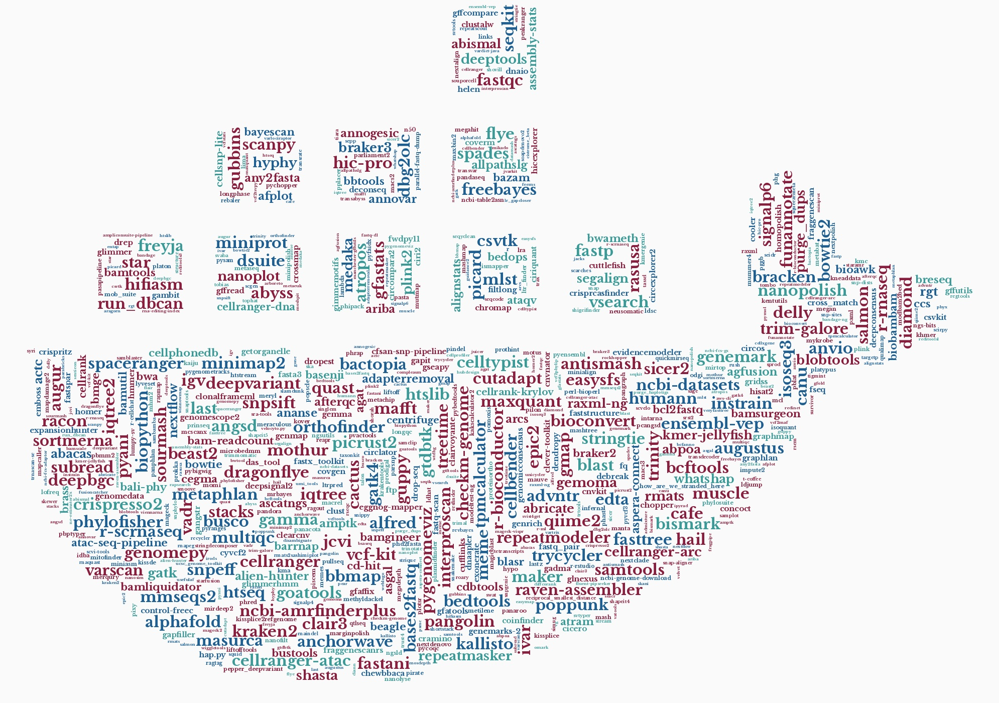

---
hide:
  - footer
search:
  exclude: false
---

# Biocontainers

## What is Biocontainers?

BioContainers is a community-driven project that provides the infrastructure and basic guidelines to create, manage and distribute bioinformatics packages (e.g conda) and containers (e.g docker, singularity). BioContainers is based on the popular frameworks Conda, Docker and Singularity.

{ align=center width=800px }
!!! tip "Fun fact"
    Fun fact: every name here is a biocontainer actually deployed on RCAC clusters (a total of **670+**). Bigger names mean more deployed versions.

## What are the advantages of using Biocontainers
Biocontainers are based on the popular container techonlogy. Due to their ease of deployment and portability, RCAC can deploy a large number of bioinformatic applications on our clusters, and keep adding newer versions. In addition, containerized applications can help improve reproductivity of scientists’ research. Using biocontainers, you can generate the same results no matter which cluster you are using, and no matter whether you run the program today or 10 years later.

## Getting Started

Please refer to our official [RCAC Biocontainers Documentation website](https://biocontainer-doc.readthedocs.io/index.html) to learn more about how to use biocontainers on RCAC resources. Below is a list of available biocontainers catalog across RCAC clusters.

## Available Biocontainers on RCAC Clusters
<!-- IMPORTANT: this section is automatically generated by script ./tools/update_bio_catalog.sh. Any manual edit will be lost after next update. -->
<!-- BIO_TABLE_START -->
As of **October 27, 2026**, there have been a total of **670** biocontainers with **4475** available versions deployed across **6** RCAC HPC clusters: **Anvil, Bell, Gautschi, Gilbreth, Negishi and Scholar**.

<table id="bioTable" class="tablefilter container-catalog-table">
  <thead>
    <tr><th scope="col"><strong>Biocontainer</strong></th><th scope="col"><strong>Available at</strong></th></tr>
  </thead>
  <tbody>
    <tr>
      <td><a href="https://biocontainer-doc.readthedocs.io/source/abacas/abacas.html"><strong>abacas</strong></a></td>
      <td>ANVIL, BELL, GAUTSCHI, NEGISHI, SCHOLAR</td>
    </tr>
    <tr>
      <td><a href="https://biocontainer-doc.readthedocs.io/source/abismal/abismal.html"><strong>abismal</strong></a></td>
      <td>ANVIL, BELL, GAUTSCHI, NEGISHI, SCHOLAR</td>
    </tr>
    <tr>
      <td><a href="https://biocontainer-doc.readthedocs.io/source/abpoa/abpoa.html"><strong>abpoa</strong></a></td>
      <td>ANVIL, BELL, GAUTSCHI, NEGISHI, SCHOLAR</td>
    </tr>
    <tr>
      <td><a href="https://biocontainer-doc.readthedocs.io/source/abricate/abricate.html"><strong>abricate</strong></a></td>
      <td>ANVIL, BELL, GAUTSCHI, NEGISHI, SCHOLAR</td>
    </tr>
    <tr>
      <td><a href="https://biocontainer-doc.readthedocs.io/source/abyss/abyss.html"><strong>abyss</strong></a></td>
      <td>ANVIL, BELL, GAUTSCHI, NEGISHI, SCHOLAR</td>
    </tr>
    <tr>
      <td><a href="https://biocontainer-doc.readthedocs.io/source/actc/actc.html"><strong>actc</strong></a></td>
      <td>ANVIL, BELL, GAUTSCHI, NEGISHI, SCHOLAR</td>
    </tr>
    <tr>
      <td><a href="https://biocontainer-doc.readthedocs.io/source/adapterremoval/adapterremoval.html"><strong>adapterremoval</strong></a></td>
      <td>ANVIL, BELL, GAUTSCHI, NEGISHI, SCHOLAR</td>
    </tr>
    <tr>
      <td><a href="https://biocontainer-doc.readthedocs.io/source/admixture/admixture.html"><strong>admixture</strong></a></td>
      <td>ANVIL, BELL, NEGISHI</td>
    </tr>
    <tr>
      <td><a href="https://biocontainer-doc.readthedocs.io/source/advntr/advntr.html"><strong>advntr</strong></a></td>
      <td>ANVIL, BELL, GAUTSCHI, NEGISHI, SCHOLAR</td>
    </tr>
    <tr>
      <td><a href="https://biocontainer-doc.readthedocs.io/source/afplot/afplot.html"><strong>afplot</strong></a></td>
      <td>ANVIL, BELL, GAUTSCHI, NEGISHI, SCHOLAR</td>
    </tr>
    <tr>
      <td><a href="https://biocontainer-doc.readthedocs.io/source/afterqc/afterqc.html"><strong>afterqc</strong></a></td>
      <td>ANVIL, BELL, GAUTSCHI, NEGISHI, SCHOLAR</td>
    </tr>
    <tr>
      <td><a href="https://biocontainer-doc.readthedocs.io/source/agat/agat.html"><strong>agat</strong></a></td>
      <td>ANVIL, BELL, GAUTSCHI, NEGISHI, SCHOLAR</td>
    </tr>
    <tr>
      <td><a href="https://biocontainer-doc.readthedocs.io/source/agfusion/agfusion.html"><strong>agfusion</strong></a></td>
      <td>ANVIL, BELL, GAUTSCHI, NEGISHI, SCHOLAR</td>
    </tr>
    <tr>
      <td><a href="https://biocontainer-doc.readthedocs.io/source/alfred/alfred.html"><strong>alfred</strong></a></td>
      <td>ANVIL, BELL, GAUTSCHI, NEGISHI, SCHOLAR</td>
    </tr>
    <tr>
      <td><a href="https://biocontainer-doc.readthedocs.io/source/alien-hunter/alien-hunter.html"><strong>alien-hunter</strong></a></td>
      <td>ANVIL, BELL, GAUTSCHI, NEGISHI, SCHOLAR</td>
    </tr>
    <tr>
      <td><a href="https://biocontainer-doc.readthedocs.io/source/alignstats/alignstats.html"><strong>alignstats</strong></a></td>
      <td>ANVIL, BELL, GAUTSCHI, NEGISHI, SCHOLAR</td>
    </tr>
    <tr>
      <td><a href="https://biocontainer-doc.readthedocs.io/source/allpathslg/allpathslg.html"><strong>allpathslg</strong></a></td>
      <td>ANVIL, BELL, GAUTSCHI, NEGISHI, SCHOLAR</td>
    </tr>
    <tr>
      <td><a href="https://biocontainer-doc.readthedocs.io/source/alphafold/alphafold.html"><strong>alphafold</strong></a></td>
      <td>ANVIL, BELL, GAUTSCHI, GILBRETH, NEGISHI, SCHOLAR</td>
    </tr>
    <tr>
      <td><a href="https://biocontainer-doc.readthedocs.io/source/ampliconsuite-pipeline/ampliconsuite-pipeline.html"><strong>ampliconsuite-pipeline</strong></a></td>
      <td>GAUTSCHI, NEGISHI</td>
    </tr>
    <tr>
      <td><a href="https://biocontainer-doc.readthedocs.io/source/amptk/amptk.html"><strong>amptk</strong></a></td>
      <td>ANVIL, BELL, GAUTSCHI, NEGISHI, SCHOLAR</td>
    </tr>
    <tr>
      <td><a href="https://biocontainer-doc.readthedocs.io/source/ananse/ananse.html"><strong>ananse</strong></a></td>
      <td>ANVIL, BELL, GAUTSCHI, NEGISHI, SCHOLAR</td>
    </tr>
    <tr>
      <td><a href="https://biocontainer-doc.readthedocs.io/source/anchorwave/anchorwave.html"><strong>anchorwave</strong></a></td>
      <td>ANVIL, BELL, GAUTSCHI, NEGISHI, SCHOLAR</td>
    </tr>
    <tr>
      <td><a href="https://biocontainer-doc.readthedocs.io/source/angsd/angsd.html"><strong>angsd</strong></a></td>
      <td>ANVIL, BELL, GAUTSCHI, NEGISHI, SCHOLAR</td>
    </tr>
    <tr>
      <td><a href="https://biocontainer-doc.readthedocs.io/source/annogesic/annogesic.html"><strong>annogesic</strong></a></td>
      <td>ANVIL, BELL, GAUTSCHI, NEGISHI, SCHOLAR</td>
    </tr>
    <tr>
      <td><a href="https://biocontainer-doc.readthedocs.io/source/annovar/annovar.html"><strong>annovar</strong></a></td>
      <td>ANVIL, BELL, GAUTSCHI, NEGISHI, SCHOLAR</td>
    </tr>
    <tr>
      <td><a href="https://biocontainer-doc.readthedocs.io/source/antismash/antismash.html"><strong>antismash</strong></a></td>
      <td>ANVIL, BELL, GAUTSCHI, NEGISHI, SCHOLAR</td>
    </tr>
    <tr>
      <td><a href="https://biocontainer-doc.readthedocs.io/source/anvio/anvio.html"><strong>anvio</strong></a></td>
      <td>ANVIL, BELL, GAUTSCHI, NEGISHI, SCHOLAR</td>
    </tr>
    <tr>
      <td><a href="https://biocontainer-doc.readthedocs.io/source/any2fasta/any2fasta.html"><strong>any2fasta</strong></a></td>
      <td>ANVIL, BELL, GAUTSCHI, NEGISHI, SCHOLAR</td>
    </tr>
    <tr>
      <td><a href="https://biocontainer-doc.readthedocs.io/source/aragorn/aragorn.html"><strong>aragorn</strong></a></td>
      <td>NEGISHI</td>
    </tr>
    <tr>
      <td><a href="https://biocontainer-doc.readthedocs.io/source/arboreto/arboreto.html"><strong>arboreto</strong></a></td>
      <td>ANVIL, BELL, GAUTSCHI, NEGISHI</td>
    </tr>
    <tr>
      <td><a href="https://biocontainer-doc.readthedocs.io/source/arcs/arcs.html"><strong>arcs</strong></a></td>
      <td>ANVIL, BELL, GAUTSCHI, NEGISHI, SCHOLAR</td>
    </tr>
    <tr>
      <td><a href="https://biocontainer-doc.readthedocs.io/source/ariba/ariba.html"><strong>ariba</strong></a></td>
      <td>ANVIL, BELL, GAUTSCHI, NEGISHI, SCHOLAR</td>
    </tr>
    <tr>
      <td><a href="https://biocontainer-doc.readthedocs.io/source/ascatngs/ascatngs.html"><strong>ascatngs</strong></a></td>
      <td>ANVIL, BELL, GAUTSCHI, NEGISHI, SCHOLAR</td>
    </tr>
    <tr>
      <td><a href="https://biocontainer-doc.readthedocs.io/source/asgal/asgal.html"><strong>asgal</strong></a></td>
      <td>ANVIL, BELL, GAUTSCHI, NEGISHI, SCHOLAR</td>
    </tr>
    <tr>
      <td><a href="https://biocontainer-doc.readthedocs.io/source/aspera-connect/aspera-connect.html"><strong>aspera-connect</strong></a></td>
      <td>ANVIL, BELL, GAUTSCHI, NEGISHI, SCHOLAR</td>
    </tr>
    <tr>
      <td><a href="https://biocontainer-doc.readthedocs.io/source/assembly-stats/assembly-stats.html"><strong>assembly-stats</strong></a></td>
      <td>ANVIL, BELL, GAUTSCHI, NEGISHI, SCHOLAR</td>
    </tr>
    <tr>
      <td><a href="https://biocontainer-doc.readthedocs.io/source/atac-seq-pipeline/atac-seq-pipeline.html"><strong>atac-seq-pipeline</strong></a></td>
      <td>ANVIL, BELL, GAUTSCHI, NEGISHI, SCHOLAR</td>
    </tr>
    <tr>
      <td><a href="https://biocontainer-doc.readthedocs.io/source/ataqv/ataqv.html"><strong>ataqv</strong></a></td>
      <td>ANVIL, BELL, GAUTSCHI, NEGISHI, SCHOLAR</td>
    </tr>
    <tr>
      <td><a href="https://biocontainer-doc.readthedocs.io/source/atram/atram.html"><strong>atram</strong></a></td>
      <td>ANVIL, BELL, GAUTSCHI, NEGISHI, SCHOLAR</td>
    </tr>
    <tr>
      <td><a href="https://biocontainer-doc.readthedocs.io/source/atropos/atropos.html"><strong>atropos</strong></a></td>
      <td>ANVIL, BELL, GAUTSCHI, NEGISHI, SCHOLAR</td>
    </tr>
    <tr>
      <td><a href="https://biocontainer-doc.readthedocs.io/source/augur/augur.html"><strong>augur</strong></a></td>
      <td>ANVIL, BELL, GAUTSCHI, NEGISHI, SCHOLAR</td>
    </tr>
    <tr>
      <td><a href="https://biocontainer-doc.readthedocs.io/source/augustus/augustus.html"><strong>augustus</strong></a></td>
      <td>ANVIL, BELL, GAUTSCHI, NEGISHI, SCHOLAR</td>
    </tr>
    <tr>
      <td><a href="https://biocontainer-doc.readthedocs.io/source/aws-cli/aws-cli.html"><strong>aws-cli</strong></a></td>
      <td>NEGISHI</td>
    </tr>
    <tr>
      <td><a href="https://biocontainer-doc.readthedocs.io/source/bactopia/bactopia.html"><strong>bactopia</strong></a></td>
      <td>ANVIL, BELL, GAUTSCHI, NEGISHI, SCHOLAR</td>
    </tr>
    <tr>
      <td><a href="https://biocontainer-doc.readthedocs.io/source/bali-phy/bali-phy.html"><strong>bali-phy</strong></a></td>
      <td>ANVIL, BELL, GAUTSCHI, NEGISHI, SCHOLAR</td>
    </tr>
    <tr>
      <td><a href="https://biocontainer-doc.readthedocs.io/source/bam-readcount/bam-readcount.html"><strong>bam-readcount</strong></a></td>
      <td>ANVIL, BELL, GAUTSCHI, NEGISHI, SCHOLAR</td>
    </tr>
    <tr>
      <td><a href="https://biocontainer-doc.readthedocs.io/source/bamgineer/bamgineer.html"><strong>bamgineer</strong></a></td>
      <td>ANVIL, BELL, GAUTSCHI, NEGISHI, SCHOLAR</td>
    </tr>
    <tr>
      <td><a href="https://biocontainer-doc.readthedocs.io/source/bamliquidator/bamliquidator.html"><strong>bamliquidator</strong></a></td>
      <td>ANVIL, BELL, GAUTSCHI, NEGISHI, SCHOLAR</td>
    </tr>
    <tr>
      <td><a href="https://biocontainer-doc.readthedocs.io/source/bamscale/bamscale.html"><strong>bamscale</strong></a></td>
      <td>ANVIL, BELL, GAUTSCHI, NEGISHI</td>
    </tr>
    <tr>
      <td><a href="https://biocontainer-doc.readthedocs.io/source/bamsurgeon/bamsurgeon.html"><strong>bamsurgeon</strong></a></td>
      <td>ANVIL, BELL, GAUTSCHI, NEGISHI, SCHOLAR</td>
    </tr>
    <tr>
      <td><a href="https://biocontainer-doc.readthedocs.io/source/bamtools/bamtools.html"><strong>bamtools</strong></a></td>
      <td>ANVIL, BELL, GAUTSCHI, NEGISHI, SCHOLAR</td>
    </tr>
    <tr>
      <td><a href="https://biocontainer-doc.readthedocs.io/source/bamutil/bamutil.html"><strong>bamutil</strong></a></td>
      <td>ANVIL, BELL, GAUTSCHI, NEGISHI, SCHOLAR</td>
    </tr>
    <tr>
      <td><a href="https://biocontainer-doc.readthedocs.io/source/bandage/bandage.html"><strong>bandage</strong></a></td>
      <td>ANVIL, BELL, GAUTSCHI, NEGISHI</td>
    </tr>
    <tr>
      <td><a href="https://biocontainer-doc.readthedocs.io/source/bandage-ng/bandage-ng.html"><strong>bandage-ng</strong></a></td>
      <td>ANVIL, BELL, GAUTSCHI, NEGISHI</td>
    </tr>
    <tr>
      <td><a href="https://biocontainer-doc.readthedocs.io/source/barrnap/barrnap.html"><strong>barrnap</strong></a></td>
      <td>ANVIL, BELL, GAUTSCHI, NEGISHI, SCHOLAR</td>
    </tr>
    <tr>
      <td><a href="https://biocontainer-doc.readthedocs.io/source/basenji/basenji.html"><strong>basenji</strong></a></td>
      <td>ANVIL, BELL, GAUTSCHI, NEGISHI, SCHOLAR</td>
    </tr>
    <tr>
      <td><a href="https://biocontainer-doc.readthedocs.io/source/bases2fastq/bases2fastq.html"><strong>bases2fastq</strong></a></td>
      <td>ANVIL, BELL, GAUTSCHI, NEGISHI</td>
    </tr>
    <tr>
      <td><a href="https://biocontainer-doc.readthedocs.io/source/bayescan/bayescan.html"><strong>bayescan</strong></a></td>
      <td>ANVIL, BELL, GAUTSCHI, NEGISHI, SCHOLAR</td>
    </tr>
    <tr>
      <td><a href="https://biocontainer-doc.readthedocs.io/source/bazam/bazam.html"><strong>bazam</strong></a></td>
      <td>ANVIL, BELL, GAUTSCHI, NEGISHI, SCHOLAR</td>
    </tr>
    <tr>
      <td><a href="https://biocontainer-doc.readthedocs.io/source/bbmap/bbmap.html"><strong>bbmap</strong></a></td>
      <td>ANVIL, BELL, GAUTSCHI, NEGISHI, SCHOLAR</td>
    </tr>
    <tr>
      <td><a href="https://biocontainer-doc.readthedocs.io/source/bbtools/bbtools.html"><strong>bbtools</strong></a></td>
      <td>ANVIL, BELL, GAUTSCHI, NEGISHI, SCHOLAR</td>
    </tr>
    <tr>
      <td><a href="https://biocontainer-doc.readthedocs.io/source/bcfanno/bcfanno.html"><strong>bcfanno</strong></a></td>
      <td>ANVIL, BELL, GAUTSCHI, NEGISHI</td>
    </tr>
    <tr>
      <td><a href="https://biocontainer-doc.readthedocs.io/source/bcftools/bcftools.html"><strong>bcftools</strong></a></td>
      <td>ANVIL, BELL, GAUTSCHI, NEGISHI, SCHOLAR</td>
    </tr>
    <tr>
      <td><a href="https://biocontainer-doc.readthedocs.io/source/bcl2fastq/bcl2fastq.html"><strong>bcl2fastq</strong></a></td>
      <td>ANVIL, BELL, GAUTSCHI, NEGISHI, SCHOLAR</td>
    </tr>
    <tr>
      <td><a href="https://biocontainer-doc.readthedocs.io/source/beagle/beagle.html"><strong>beagle</strong></a></td>
      <td>ANVIL, BELL, GAUTSCHI, NEGISHI, SCHOLAR</td>
    </tr>
    <tr>
      <td><a href="https://biocontainer-doc.readthedocs.io/source/beast2/beast2.html"><strong>beast2</strong></a></td>
      <td>ANVIL, BELL, GAUTSCHI, NEGISHI, SCHOLAR</td>
    </tr>
    <tr>
      <td><a href="https://biocontainer-doc.readthedocs.io/source/bedops/bedops.html"><strong>bedops</strong></a></td>
      <td>ANVIL, BELL, GAUTSCHI, NEGISHI, SCHOLAR</td>
    </tr>
    <tr>
      <td><a href="https://biocontainer-doc.readthedocs.io/source/bedtools/bedtools.html"><strong>bedtools</strong></a></td>
      <td>ANVIL, BELL, GAUTSCHI, NEGISHI, SCHOLAR</td>
    </tr>
    <tr>
      <td><a href="https://biocontainer-doc.readthedocs.io/source/bioawk/bioawk.html"><strong>bioawk</strong></a></td>
      <td>ANVIL, BELL, GAUTSCHI, NEGISHI, SCHOLAR</td>
    </tr>
    <tr>
      <td><a href="https://biocontainer-doc.readthedocs.io/source/biobambam/biobambam.html"><strong>biobambam</strong></a></td>
      <td>ANVIL, BELL, GAUTSCHI, NEGISHI, SCHOLAR</td>
    </tr>
    <tr>
      <td><a href="https://biocontainer-doc.readthedocs.io/source/bioconvert/bioconvert.html"><strong>bioconvert</strong></a></td>
      <td>ANVIL, BELL, GAUTSCHI, NEGISHI, SCHOLAR</td>
    </tr>
    <tr>
      <td><a href="https://biocontainer-doc.readthedocs.io/source/biopython/biopython.html"><strong>biopython</strong></a></td>
      <td>ANVIL, BELL, GAUTSCHI, NEGISHI, SCHOLAR</td>
    </tr>
    <tr>
      <td><a href="https://biocontainer-doc.readthedocs.io/source/bismark/bismark.html"><strong>bismark</strong></a></td>
      <td>ANVIL, BELL, GAUTSCHI, NEGISHI, SCHOLAR</td>
    </tr>
    <tr>
      <td><a href="https://biocontainer-doc.readthedocs.io/source/blasr/blasr.html"><strong>blasr</strong></a></td>
      <td>ANVIL, BELL, GAUTSCHI, NEGISHI, SCHOLAR</td>
    </tr>
    <tr>
      <td><a href="https://biocontainer-doc.readthedocs.io/source/blast/blast.html"><strong>blast</strong></a></td>
      <td>ANVIL, BELL, GAUTSCHI, NEGISHI, SCHOLAR</td>
    </tr>
    <tr>
      <td><a href="https://biocontainer-doc.readthedocs.io/source/blobtools/blobtools.html"><strong>blobtools</strong></a></td>
      <td>ANVIL, BELL, GAUTSCHI, NEGISHI, SCHOLAR</td>
    </tr>
    <tr>
      <td><a href="https://biocontainer-doc.readthedocs.io/source/bmge/bmge.html"><strong>bmge</strong></a></td>
      <td>ANVIL, BELL, GAUTSCHI, NEGISHI, SCHOLAR</td>
    </tr>
    <tr>
      <td><a href="https://biocontainer-doc.readthedocs.io/source/bowtie/bowtie.html"><strong>bowtie</strong></a></td>
      <td>ANVIL, BELL, GAUTSCHI, NEGISHI, SCHOLAR</td>
    </tr>
    <tr>
      <td><a href="https://biocontainer-doc.readthedocs.io/source/bowtie2/bowtie2.html"><strong>bowtie2</strong></a></td>
      <td>ANVIL, BELL, GAUTSCHI, NEGISHI, SCHOLAR</td>
    </tr>
    <tr>
      <td><a href="https://biocontainer-doc.readthedocs.io/source/bracken/bracken.html"><strong>bracken</strong></a></td>
      <td>ANVIL, BELL, GAUTSCHI, NEGISHI, SCHOLAR</td>
    </tr>
    <tr>
      <td><a href="https://biocontainer-doc.readthedocs.io/source/braker2/braker2.html"><strong>braker2</strong></a></td>
      <td>ANVIL, BELL, GAUTSCHI, NEGISHI, SCHOLAR</td>
    </tr>
    <tr>
      <td><a href="https://biocontainer-doc.readthedocs.io/source/braker3/braker3.html"><strong>braker3</strong></a></td>
      <td>ANVIL, BELL, GAUTSCHI, NEGISHI</td>
    </tr>
    <tr>
      <td><a href="https://biocontainer-doc.readthedocs.io/source/brass/brass.html"><strong>brass</strong></a></td>
      <td>ANVIL, BELL, GAUTSCHI, NEGISHI, SCHOLAR</td>
    </tr>
    <tr>
      <td><a href="https://biocontainer-doc.readthedocs.io/source/breseq/breseq.html"><strong>breseq</strong></a></td>
      <td>ANVIL, BELL, GAUTSCHI, NEGISHI, SCHOLAR</td>
    </tr>
    <tr>
      <td><a href="https://biocontainer-doc.readthedocs.io/source/bsaseq/bsaseq.html"><strong>bsaseq</strong></a></td>
      <td>BELL, NEGISHI</td>
    </tr>
    <tr>
      <td><a href="https://biocontainer-doc.readthedocs.io/source/busco/busco.html"><strong>busco</strong></a></td>
      <td>ANVIL, BELL, GAUTSCHI, NEGISHI, SCHOLAR</td>
    </tr>
    <tr>
      <td><a href="https://biocontainer-doc.readthedocs.io/source/bustools/bustools.html"><strong>bustools</strong></a></td>
      <td>ANVIL, BELL, GAUTSCHI, NEGISHI, SCHOLAR</td>
    </tr>
    <tr>
      <td><a href="https://biocontainer-doc.readthedocs.io/source/bwa/bwa.html"><strong>bwa</strong></a></td>
      <td>ANVIL, BELL, GAUTSCHI, NEGISHI, SCHOLAR</td>
    </tr>
    <tr>
      <td><a href="https://biocontainer-doc.readthedocs.io/source/bwameth/bwameth.html"><strong>bwameth</strong></a></td>
      <td>ANVIL, BELL, GAUTSCHI, NEGISHI, SCHOLAR</td>
    </tr>
    <tr>
      <td><a href="https://biocontainer-doc.readthedocs.io/source/bwtool/bwtool.html"><strong>bwtool</strong></a></td>
      <td>ANVIL, BELL, GAUTSCHI, NEGISHI</td>
    </tr>
    <tr>
      <td><a href="https://biocontainer-doc.readthedocs.io/source/cactus/cactus.html"><strong>cactus</strong></a></td>
      <td>ANVIL, BELL, GAUTSCHI, GILBRETH, NEGISHI, SCHOLAR</td>
    </tr>
    <tr>
      <td><a href="https://biocontainer-doc.readthedocs.io/source/cafe/cafe.html"><strong>cafe</strong></a></td>
      <td>ANVIL, BELL, GAUTSCHI, NEGISHI, SCHOLAR</td>
    </tr>
    <tr>
      <td><a href="https://biocontainer-doc.readthedocs.io/source/canu/canu.html"><strong>canu</strong></a></td>
      <td>ANVIL, BELL, GAUTSCHI, NEGISHI, SCHOLAR</td>
    </tr>
    <tr>
      <td><a href="https://biocontainer-doc.readthedocs.io/source/ccs/ccs.html"><strong>ccs</strong></a></td>
      <td>ANVIL, BELL, GAUTSCHI, NEGISHI, SCHOLAR</td>
    </tr>
    <tr>
      <td><a href="https://biocontainer-doc.readthedocs.io/source/cd-hit/cd-hit.html"><strong>cd-hit</strong></a></td>
      <td>ANVIL, BELL, GAUTSCHI, NEGISHI, SCHOLAR</td>
    </tr>
    <tr>
      <td><a href="https://biocontainer-doc.readthedocs.io/source/cdbtools/cdbtools.html"><strong>cdbtools</strong></a></td>
      <td>ANVIL, BELL, GAUTSCHI, NEGISHI, SCHOLAR</td>
    </tr>
    <tr>
      <td><a href="https://biocontainer-doc.readthedocs.io/source/cegma/cegma.html"><strong>cegma</strong></a></td>
      <td>ANVIL, BELL, GAUTSCHI, NEGISHI, SCHOLAR</td>
    </tr>
    <tr>
      <td><a href="https://biocontainer-doc.readthedocs.io/source/cellbender/cellbender.html"><strong>cellbender</strong></a></td>
      <td>ANVIL, BELL, GAUTSCHI, NEGISHI, SCHOLAR</td>
    </tr>
    <tr>
      <td><a href="https://biocontainer-doc.readthedocs.io/source/cellphonedb/cellphonedb.html"><strong>cellphonedb</strong></a></td>
      <td>ANVIL, BELL, GAUTSCHI, NEGISHI, SCHOLAR</td>
    </tr>
    <tr>
      <td><a href="https://biocontainer-doc.readthedocs.io/source/cellprofiler/cellprofiler.html"><strong>cellprofiler</strong></a></td>
      <td>BELL, NEGISHI, SCHOLAR</td>
    </tr>
    <tr>
      <td><a href="https://biocontainer-doc.readthedocs.io/source/cellranger/cellranger.html"><strong>cellranger</strong></a></td>
      <td>ANVIL, BELL, GAUTSCHI, NEGISHI, SCHOLAR</td>
    </tr>
    <tr>
      <td><a href="https://biocontainer-doc.readthedocs.io/source/cellranger-arc/cellranger-arc.html"><strong>cellranger-arc</strong></a></td>
      <td>ANVIL, BELL, GAUTSCHI, NEGISHI, SCHOLAR</td>
    </tr>
    <tr>
      <td><a href="https://biocontainer-doc.readthedocs.io/source/cellranger-atac/cellranger-atac.html"><strong>cellranger-atac</strong></a></td>
      <td>ANVIL, BELL, GAUTSCHI, NEGISHI, SCHOLAR</td>
    </tr>
    <tr>
      <td><a href="https://biocontainer-doc.readthedocs.io/source/cellranger-dna/cellranger-dna.html"><strong>cellranger-dna</strong></a></td>
      <td>ANVIL, BELL, GAUTSCHI, NEGISHI, SCHOLAR</td>
    </tr>
    <tr>
      <td><a href="https://biocontainer-doc.readthedocs.io/source/cellrank/cellrank.html"><strong>cellrank</strong></a></td>
      <td>ANVIL, BELL, GAUTSCHI, NEGISHI, SCHOLAR</td>
    </tr>
    <tr>
      <td><a href="https://biocontainer-doc.readthedocs.io/source/cellrank-krylov/cellrank-krylov.html"><strong>cellrank-krylov</strong></a></td>
      <td>ANVIL, BELL, GAUTSCHI, NEGISHI, SCHOLAR</td>
    </tr>
    <tr>
      <td><a href="https://biocontainer-doc.readthedocs.io/source/cellsnp-lite/cellsnp-lite.html"><strong>cellsnp-lite</strong></a></td>
      <td>ANVIL, BELL, GAUTSCHI, NEGISHI, SCHOLAR</td>
    </tr>
    <tr>
      <td><a href="https://biocontainer-doc.readthedocs.io/source/celltypist/celltypist.html"><strong>celltypist</strong></a></td>
      <td>ANVIL, BELL, GAUTSCHI, NEGISHI, SCHOLAR</td>
    </tr>
    <tr>
      <td><a href="https://biocontainer-doc.readthedocs.io/source/cellxgene/cellxgene.html"><strong>cellxgene</strong></a></td>
      <td>BELL, NEGISHI</td>
    </tr>
    <tr>
      <td><a href="https://biocontainer-doc.readthedocs.io/source/centrifuge/centrifuge.html"><strong>centrifuge</strong></a></td>
      <td>ANVIL, BELL, GAUTSCHI, NEGISHI, SCHOLAR</td>
    </tr>
    <tr>
      <td><a href="https://biocontainer-doc.readthedocs.io/source/cfsan-snp-pipeline/cfsan-snp-pipeline.html"><strong>cfsan-snp-pipeline</strong></a></td>
      <td>ANVIL, BELL, GAUTSCHI, NEGISHI, SCHOLAR</td>
    </tr>
    <tr>
      <td><a href="https://biocontainer-doc.readthedocs.io/source/checkm-genome/checkm-genome.html"><strong>checkm-genome</strong></a></td>
      <td>ANVIL, BELL, GAUTSCHI, NEGISHI, SCHOLAR</td>
    </tr>
    <tr>
      <td><a href="https://biocontainer-doc.readthedocs.io/source/chewbbaca/chewbbaca.html"><strong>chewbbaca</strong></a></td>
      <td>ANVIL, BELL, GAUTSCHI, NEGISHI, SCHOLAR</td>
    </tr>
    <tr>
      <td><a href="https://biocontainer-doc.readthedocs.io/source/chopper/chopper.html"><strong>chopper</strong></a></td>
      <td>ANVIL, BELL, GAUTSCHI, NEGISHI, SCHOLAR</td>
    </tr>
    <tr>
      <td><a href="https://biocontainer-doc.readthedocs.io/source/chromap/chromap.html"><strong>chromap</strong></a></td>
      <td>ANVIL, BELL, GAUTSCHI, NEGISHI, SCHOLAR</td>
    </tr>
    <tr>
      <td><a href="https://biocontainer-doc.readthedocs.io/source/cicero/cicero.html"><strong>cicero</strong></a></td>
      <td>ANVIL, BELL, GAUTSCHI, NEGISHI, SCHOLAR</td>
    </tr>
    <tr>
      <td><a href="https://biocontainer-doc.readthedocs.io/source/circexplorer2/circexplorer2.html"><strong>circexplorer2</strong></a></td>
      <td>ANVIL, BELL, GAUTSCHI, NEGISHI, SCHOLAR</td>
    </tr>
    <tr>
      <td><a href="https://biocontainer-doc.readthedocs.io/source/circlator/circlator.html"><strong>circlator</strong></a></td>
      <td>ANVIL, BELL, GAUTSCHI, NEGISHI, SCHOLAR</td>
    </tr>
    <tr>
      <td><a href="https://biocontainer-doc.readthedocs.io/source/circompara2/circompara2.html"><strong>circompara2</strong></a></td>
      <td>ANVIL, BELL, GAUTSCHI, NEGISHI, SCHOLAR</td>
    </tr>
    <tr>
      <td><a href="https://biocontainer-doc.readthedocs.io/source/circos/circos.html"><strong>circos</strong></a></td>
      <td>ANVIL, BELL, GAUTSCHI, NEGISHI, SCHOLAR</td>
    </tr>
    <tr>
      <td><a href="https://biocontainer-doc.readthedocs.io/source/ciri2/ciri2.html"><strong>ciri2</strong></a></td>
      <td>ANVIL, BELL, GAUTSCHI, NEGISHI, SCHOLAR</td>
    </tr>
    <tr>
      <td><a href="https://biocontainer-doc.readthedocs.io/source/ciriquant/ciriquant.html"><strong>ciriquant</strong></a></td>
      <td>ANVIL, BELL, GAUTSCHI, NEGISHI, SCHOLAR</td>
    </tr>
    <tr>
      <td><a href="https://biocontainer-doc.readthedocs.io/source/cistrome_beta/cistrome_beta.html"><strong>cistrome_beta</strong></a></td>
      <td>NEGISHI</td>
    </tr>
    <tr>
      <td><a href="https://biocontainer-doc.readthedocs.io/source/clair3/clair3.html"><strong>clair3</strong></a></td>
      <td>ANVIL, BELL, GAUTSCHI, NEGISHI, SCHOLAR</td>
    </tr>
    <tr>
      <td><a href="https://biocontainer-doc.readthedocs.io/source/clairvoyante/clairvoyante.html"><strong>clairvoyante</strong></a></td>
      <td>ANVIL, BELL, GAUTSCHI, NEGISHI, SCHOLAR</td>
    </tr>
    <tr>
      <td><a href="https://biocontainer-doc.readthedocs.io/source/clearcnv/clearcnv.html"><strong>clearcnv</strong></a></td>
      <td>ANVIL, BELL, GAUTSCHI, NEGISHI, SCHOLAR</td>
    </tr>
    <tr>
      <td><a href="https://biocontainer-doc.readthedocs.io/source/clever-toolkit/clever-toolkit.html"><strong>clever-toolkit</strong></a></td>
      <td>ANVIL, BELL, GAUTSCHI, NEGISHI, SCHOLAR</td>
    </tr>
    <tr>
      <td><a href="https://biocontainer-doc.readthedocs.io/source/clonalframeml/clonalframeml.html"><strong>clonalframeml</strong></a></td>
      <td>ANVIL, BELL, GAUTSCHI, NEGISHI, SCHOLAR</td>
    </tr>
    <tr>
      <td><a href="https://biocontainer-doc.readthedocs.io/source/clust/clust.html"><strong>clust</strong></a></td>
      <td>ANVIL, BELL, GAUTSCHI, NEGISHI, SCHOLAR</td>
    </tr>
    <tr>
      <td><a href="https://biocontainer-doc.readthedocs.io/source/clustalw/clustalw.html"><strong>clustalw</strong></a></td>
      <td>ANVIL, BELL, GAUTSCHI, NEGISHI, SCHOLAR</td>
    </tr>
    <tr>
      <td><a href="https://biocontainer-doc.readthedocs.io/source/cnvkit/cnvkit.html"><strong>cnvkit</strong></a></td>
      <td>ANVIL, BELL, GAUTSCHI, NEGISHI, SCHOLAR</td>
    </tr>
    <tr>
      <td><a href="https://biocontainer-doc.readthedocs.io/source/cnvnator/cnvnator.html"><strong>cnvnator</strong></a></td>
      <td>ANVIL, BELL, GAUTSCHI, NEGISHI, SCHOLAR</td>
    </tr>
    <tr>
      <td><a href="https://biocontainer-doc.readthedocs.io/source/coinfinder/coinfinder.html"><strong>coinfinder</strong></a></td>
      <td>ANVIL, BELL, GAUTSCHI, NEGISHI, SCHOLAR</td>
    </tr>
    <tr>
      <td><a href="https://biocontainer-doc.readthedocs.io/source/compleasm/compleasm.html"><strong>compleasm</strong></a></td>
      <td>ANVIL, BELL, NEGISHI</td>
    </tr>
    <tr>
      <td><a href="https://biocontainer-doc.readthedocs.io/source/concoct/concoct.html"><strong>concoct</strong></a></td>
      <td>ANVIL, BELL, GAUTSCHI, NEGISHI, SCHOLAR</td>
    </tr>
    <tr>
      <td><a href="https://biocontainer-doc.readthedocs.io/source/control-freec/control-freec.html"><strong>control-freec</strong></a></td>
      <td>ANVIL, BELL, GAUTSCHI, NEGISHI, SCHOLAR</td>
    </tr>
    <tr>
      <td><a href="https://biocontainer-doc.readthedocs.io/source/cooler/cooler.html"><strong>cooler</strong></a></td>
      <td>ANVIL, BELL, GAUTSCHI, NEGISHI, SCHOLAR</td>
    </tr>
    <tr>
      <td><a href="https://biocontainer-doc.readthedocs.io/source/coverm/coverm.html"><strong>coverm</strong></a></td>
      <td>ANVIL, BELL, GAUTSCHI, NEGISHI, SCHOLAR</td>
    </tr>
    <tr>
      <td><a href="https://biocontainer-doc.readthedocs.io/source/covgen/covgen.html"><strong>covgen</strong></a></td>
      <td>ANVIL, BELL, GAUTSCHI, NEGISHI, SCHOLAR</td>
    </tr>
    <tr>
      <td><a href="https://biocontainer-doc.readthedocs.io/source/cramino/cramino.html"><strong>cramino</strong></a></td>
      <td>ANVIL, BELL, GAUTSCHI, NEGISHI, SCHOLAR</td>
    </tr>
    <tr>
      <td><a href="https://biocontainer-doc.readthedocs.io/source/crisprcasfinder/crisprcasfinder.html"><strong>crisprcasfinder</strong></a></td>
      <td>ANVIL, BELL, GAUTSCHI, NEGISHI, SCHOLAR</td>
    </tr>
    <tr>
      <td><a href="https://biocontainer-doc.readthedocs.io/source/crispresso2/crispresso2.html"><strong>crispresso2</strong></a></td>
      <td>ANVIL, BELL, GAUTSCHI, NEGISHI, SCHOLAR</td>
    </tr>
    <tr>
      <td><a href="https://biocontainer-doc.readthedocs.io/source/crispritz/crispritz.html"><strong>crispritz</strong></a></td>
      <td>ANVIL, BELL, GAUTSCHI, NEGISHI, SCHOLAR</td>
    </tr>
    <tr>
      <td><a href="https://biocontainer-doc.readthedocs.io/source/cross_match/cross_match.html"><strong>cross_match</strong></a></td>
      <td>ANVIL, BELL, GAUTSCHI, NEGISHI, SCHOLAR</td>
    </tr>
    <tr>
      <td><a href="https://biocontainer-doc.readthedocs.io/source/crossmap/crossmap.html"><strong>crossmap</strong></a></td>
      <td>ANVIL, BELL, GAUTSCHI, NEGISHI, SCHOLAR</td>
    </tr>
    <tr>
      <td><a href="https://biocontainer-doc.readthedocs.io/source/csvkit/csvkit.html"><strong>csvkit</strong></a></td>
      <td>ANVIL, BELL, GAUTSCHI, NEGISHI, SCHOLAR</td>
    </tr>
    <tr>
      <td><a href="https://biocontainer-doc.readthedocs.io/source/csvtk/csvtk.html"><strong>csvtk</strong></a></td>
      <td>ANVIL, BELL, GAUTSCHI, NEGISHI, SCHOLAR</td>
    </tr>
    <tr>
      <td><a href="https://biocontainer-doc.readthedocs.io/source/cufflinks/cufflinks.html"><strong>cufflinks</strong></a></td>
      <td>ANVIL, BELL, GAUTSCHI, NEGISHI, SCHOLAR</td>
    </tr>
    <tr>
      <td><a href="https://biocontainer-doc.readthedocs.io/source/cutadapt/cutadapt.html"><strong>cutadapt</strong></a></td>
      <td>ANVIL, BELL, GAUTSCHI, NEGISHI, SCHOLAR</td>
    </tr>
    <tr>
      <td><a href="https://biocontainer-doc.readthedocs.io/source/cuttlefish/cuttlefish.html"><strong>cuttlefish</strong></a></td>
      <td>ANVIL, BELL, GAUTSCHI, NEGISHI, SCHOLAR</td>
    </tr>
    <tr>
      <td><a href="https://biocontainer-doc.readthedocs.io/source/cyvcf2/cyvcf2.html"><strong>cyvcf2</strong></a></td>
      <td>ANVIL, BELL, GAUTSCHI, NEGISHI, SCHOLAR</td>
    </tr>
    <tr>
      <td><a href="https://biocontainer-doc.readthedocs.io/source/das_tool/das_tool.html"><strong>das_tool</strong></a></td>
      <td>ANVIL, BELL, GAUTSCHI, NEGISHI, SCHOLAR</td>
    </tr>
    <tr>
      <td><a href="https://biocontainer-doc.readthedocs.io/source/datamash/datamash.html"><strong>datamash</strong></a></td>
      <td>ANVIL, BELL, GAUTSCHI, NEGISHI</td>
    </tr>
    <tr>
      <td><a href="https://biocontainer-doc.readthedocs.io/source/dbg2olc/dbg2olc.html"><strong>dbg2olc</strong></a></td>
      <td>ANVIL, BELL, GAUTSCHI, NEGISHI, SCHOLAR</td>
    </tr>
    <tr>
      <td><a href="https://biocontainer-doc.readthedocs.io/source/debreak/debreak.html"><strong>debreak</strong></a></td>
      <td>ANVIL, BELL, GAUTSCHI, NEGISHI, SCHOLAR</td>
    </tr>
    <tr>
      <td><a href="https://biocontainer-doc.readthedocs.io/source/deconseq/deconseq.html"><strong>deconseq</strong></a></td>
      <td>ANVIL, BELL, GAUTSCHI, NEGISHI, SCHOLAR</td>
    </tr>
    <tr>
      <td><a href="https://biocontainer-doc.readthedocs.io/source/deepbgc/deepbgc.html"><strong>deepbgc</strong></a></td>
      <td>ANVIL, BELL, GAUTSCHI, NEGISHI, SCHOLAR</td>
    </tr>
    <tr>
      <td><a href="https://biocontainer-doc.readthedocs.io/source/deepconsensus/deepconsensus.html"><strong>deepconsensus</strong></a></td>
      <td>ANVIL, BELL, GAUTSCHI, NEGISHI, SCHOLAR</td>
    </tr>
    <tr>
      <td><a href="https://biocontainer-doc.readthedocs.io/source/deepsignal2/deepsignal2.html"><strong>deepsignal2</strong></a></td>
      <td>ANVIL, BELL, GAUTSCHI, NEGISHI, SCHOLAR</td>
    </tr>
    <tr>
      <td><a href="https://biocontainer-doc.readthedocs.io/source/deeptools/deeptools.html"><strong>deeptools</strong></a></td>
      <td>ANVIL, BELL, GAUTSCHI, NEGISHI, SCHOLAR</td>
    </tr>
    <tr>
      <td><a href="https://biocontainer-doc.readthedocs.io/source/deepvariant/deepvariant.html"><strong>deepvariant</strong></a></td>
      <td>ANVIL, BELL, GAUTSCHI, NEGISHI, SCHOLAR</td>
    </tr>
    <tr>
      <td><a href="https://biocontainer-doc.readthedocs.io/source/delly/delly.html"><strong>delly</strong></a></td>
      <td>ANVIL, BELL, GAUTSCHI, NEGISHI, SCHOLAR</td>
    </tr>
    <tr>
      <td><a href="https://biocontainer-doc.readthedocs.io/source/dendropy/dendropy.html"><strong>dendropy</strong></a></td>
      <td>ANVIL, BELL, GAUTSCHI, NEGISHI, SCHOLAR</td>
    </tr>
    <tr>
      <td><a href="https://biocontainer-doc.readthedocs.io/source/diamond/diamond.html"><strong>diamond</strong></a></td>
      <td>ANVIL, BELL, GAUTSCHI, NEGISHI, SCHOLAR</td>
    </tr>
    <tr>
      <td><a href="https://biocontainer-doc.readthedocs.io/source/diann/diann.html"><strong>diann</strong></a></td>
      <td>NEGISHI, SCHOLAR</td>
    </tr>
    <tr>
      <td><a href="https://biocontainer-doc.readthedocs.io/source/diffcorank/diffcorank.html"><strong>diffcorank</strong></a></td>
      <td>NEGISHI</td>
    </tr>
    <tr>
      <td><a href="https://biocontainer-doc.readthedocs.io/source/disambiguate/disambiguate.html"><strong>disambiguate</strong></a></td>
      <td>NEGISHI</td>
    </tr>
    <tr>
      <td><a href="https://biocontainer-doc.readthedocs.io/source/dnaapler/dnaapler.html"><strong>dnaapler</strong></a></td>
      <td>ANVIL, BELL, GAUTSCHI, NEGISHI, SCHOLAR</td>
    </tr>
    <tr>
      <td><a href="https://biocontainer-doc.readthedocs.io/source/dnaio/dnaio.html"><strong>dnaio</strong></a></td>
      <td>ANVIL, BELL, GAUTSCHI, NEGISHI, SCHOLAR</td>
    </tr>
    <tr>
      <td><a href="https://biocontainer-doc.readthedocs.io/source/dragonflye/dragonflye.html"><strong>dragonflye</strong></a></td>
      <td>ANVIL, BELL, GAUTSCHI, NEGISHI, SCHOLAR</td>
    </tr>
    <tr>
      <td><a href="https://biocontainer-doc.readthedocs.io/source/drep/drep.html"><strong>drep</strong></a></td>
      <td>ANVIL, BELL, GAUTSCHI, NEGISHI, SCHOLAR</td>
    </tr>
    <tr>
      <td><a href="https://biocontainer-doc.readthedocs.io/source/drop-seq/drop-seq.html"><strong>drop-seq</strong></a></td>
      <td>ANVIL, BELL, GAUTSCHI, NEGISHI, SCHOLAR</td>
    </tr>
    <tr>
      <td><a href="https://biocontainer-doc.readthedocs.io/source/dropest/dropest.html"><strong>dropest</strong></a></td>
      <td>ANVIL, BELL, GAUTSCHI, NEGISHI, SCHOLAR</td>
    </tr>
    <tr>
      <td><a href="https://biocontainer-doc.readthedocs.io/source/dsuite/dsuite.html"><strong>dsuite</strong></a></td>
      <td>ANVIL, BELL, GAUTSCHI, NEGISHI, SCHOLAR</td>
    </tr>
    <tr>
      <td><a href="https://biocontainer-doc.readthedocs.io/source/easymap/easymap.html"><strong>easymap</strong></a></td>
      <td>BELL, NEGISHI</td>
    </tr>
    <tr>
      <td><a href="https://biocontainer-doc.readthedocs.io/source/easysfs/easysfs.html"><strong>easysfs</strong></a></td>
      <td>ANVIL, BELL, GAUTSCHI, NEGISHI, SCHOLAR</td>
    </tr>
    <tr>
      <td><a href="https://biocontainer-doc.readthedocs.io/source/edta/edta.html"><strong>edta</strong></a></td>
      <td>ANVIL, BELL, GAUTSCHI, NEGISHI, SCHOLAR</td>
    </tr>
    <tr>
      <td><a href="https://biocontainer-doc.readthedocs.io/source/eggnog-mapper/eggnog-mapper.html"><strong>eggnog-mapper</strong></a></td>
      <td>ANVIL, BELL, GAUTSCHI, NEGISHI, SCHOLAR</td>
    </tr>
    <tr>
      <td><a href="https://biocontainer-doc.readthedocs.io/source/emboss/emboss.html"><strong>emboss</strong></a></td>
      <td>ANVIL, BELL, GAUTSCHI, NEGISHI, SCHOLAR</td>
    </tr>
    <tr>
      <td><a href="https://biocontainer-doc.readthedocs.io/source/ensembl-vep/ensembl-vep.html"><strong>ensembl-vep</strong></a></td>
      <td>ANVIL, BELL, GAUTSCHI, NEGISHI, SCHOLAR</td>
    </tr>
    <tr>
      <td><a href="https://biocontainer-doc.readthedocs.io/source/entap/entap.html"><strong>entap</strong></a></td>
      <td>BELL, NEGISHI</td>
    </tr>
    <tr>
      <td><a href="https://biocontainer-doc.readthedocs.io/source/epic2/epic2.html"><strong>epic2</strong></a></td>
      <td>ANVIL, BELL, GAUTSCHI, NEGISHI, SCHOLAR</td>
    </tr>
    <tr>
      <td><a href="https://biocontainer-doc.readthedocs.io/source/evidencemodeler/evidencemodeler.html"><strong>evidencemodeler</strong></a></td>
      <td>ANVIL, BELL, GAUTSCHI, NEGISHI, SCHOLAR</td>
    </tr>
    <tr>
      <td><a href="https://biocontainer-doc.readthedocs.io/source/exonerate/exonerate.html"><strong>exonerate</strong></a></td>
      <td>ANVIL, BELL, GAUTSCHI, NEGISHI, SCHOLAR</td>
    </tr>
    <tr>
      <td><a href="https://biocontainer-doc.readthedocs.io/source/expansionhunter/expansionhunter.html"><strong>expansionhunter</strong></a></td>
      <td>ANVIL, BELL, GAUTSCHI, NEGISHI, SCHOLAR</td>
    </tr>
    <tr>
      <td><a href="https://biocontainer-doc.readthedocs.io/source/fasta3/fasta3.html"><strong>fasta3</strong></a></td>
      <td>ANVIL, BELL, GAUTSCHI, NEGISHI, SCHOLAR</td>
    </tr>
    <tr>
      <td><a href="https://biocontainer-doc.readthedocs.io/source/fastani/fastani.html"><strong>fastani</strong></a></td>
      <td>ANVIL, BELL, GAUTSCHI, NEGISHI, SCHOLAR</td>
    </tr>
    <tr>
      <td><a href="https://biocontainer-doc.readthedocs.io/source/fastp/fastp.html"><strong>fastp</strong></a></td>
      <td>ANVIL, BELL, GAUTSCHI, NEGISHI, SCHOLAR</td>
    </tr>
    <tr>
      <td><a href="https://biocontainer-doc.readthedocs.io/source/fastq-dl/fastq-dl.html"><strong>fastq-dl</strong></a></td>
      <td>BELL, GAUTSCHI, NEGISHI</td>
    </tr>
    <tr>
      <td><a href="https://biocontainer-doc.readthedocs.io/source/fastq-scan/fastq-scan.html"><strong>fastq-scan</strong></a></td>
      <td>ANVIL, BELL, GAUTSCHI, NEGISHI, SCHOLAR</td>
    </tr>
    <tr>
      <td><a href="https://biocontainer-doc.readthedocs.io/source/fastq_pair/fastq_pair.html"><strong>fastq_pair</strong></a></td>
      <td>ANVIL, BELL, GAUTSCHI, NEGISHI, SCHOLAR</td>
    </tr>
    <tr>
      <td><a href="https://biocontainer-doc.readthedocs.io/source/fastqc/fastqc.html"><strong>fastqc</strong></a></td>
      <td>ANVIL, BELL, GAUTSCHI, NEGISHI, SCHOLAR</td>
    </tr>
    <tr>
      <td><a href="https://biocontainer-doc.readthedocs.io/source/fastspar/fastspar.html"><strong>fastspar</strong></a></td>
      <td>ANVIL, BELL, GAUTSCHI, NEGISHI, SCHOLAR</td>
    </tr>
    <tr>
      <td><a href="https://biocontainer-doc.readthedocs.io/source/faststructure/faststructure.html"><strong>faststructure</strong></a></td>
      <td>ANVIL, BELL, GAUTSCHI, NEGISHI, SCHOLAR</td>
    </tr>
    <tr>
      <td><a href="https://biocontainer-doc.readthedocs.io/source/fasttree/fasttree.html"><strong>fasttree</strong></a></td>
      <td>ANVIL, BELL, GAUTSCHI, NEGISHI, SCHOLAR</td>
    </tr>
    <tr>
      <td><a href="https://biocontainer-doc.readthedocs.io/source/fastx_toolkit/fastx_toolkit.html"><strong>fastx_toolkit</strong></a></td>
      <td>ANVIL, BELL, GAUTSCHI, NEGISHI, SCHOLAR</td>
    </tr>
    <tr>
      <td><a href="https://biocontainer-doc.readthedocs.io/source/feems/feems.html"><strong>feems</strong></a></td>
      <td>ANVIL</td>
    </tr>
    <tr>
      <td><a href="https://biocontainer-doc.readthedocs.io/source/filtlong/filtlong.html"><strong>filtlong</strong></a></td>
      <td>ANVIL, BELL, GAUTSCHI, NEGISHI, SCHOLAR</td>
    </tr>
    <tr>
      <td><a href="https://biocontainer-doc.readthedocs.io/source/flair/flair.html"><strong>flair</strong></a></td>
      <td>ANVIL, BELL, NEGISHI</td>
    </tr>
    <tr>
      <td><a href="https://biocontainer-doc.readthedocs.io/source/fluent-pipseeker/fluent-pipseeker.html"><strong>fluent-pipseeker</strong></a></td>
      <td>BELL, NEGISHI</td>
    </tr>
    <tr>
      <td><a href="https://biocontainer-doc.readthedocs.io/source/flye/flye.html"><strong>flye</strong></a></td>
      <td>ANVIL, BELL, GAUTSCHI, NEGISHI, SCHOLAR</td>
    </tr>
    <tr>
      <td><a href="https://biocontainer-doc.readthedocs.io/source/fq/fq.html"><strong>fq</strong></a></td>
      <td>ANVIL, BELL, GAUTSCHI, NEGISHI, SCHOLAR</td>
    </tr>
    <tr>
      <td><a href="https://biocontainer-doc.readthedocs.io/source/fraggenescan/fraggenescan.html"><strong>fraggenescan</strong></a></td>
      <td>ANVIL, BELL, GAUTSCHI, NEGISHI, SCHOLAR</td>
    </tr>
    <tr>
      <td><a href="https://biocontainer-doc.readthedocs.io/source/fraggenescanrs/fraggenescanrs.html"><strong>fraggenescanrs</strong></a></td>
      <td>ANVIL, BELL, GAUTSCHI, NEGISHI, SCHOLAR</td>
    </tr>
    <tr>
      <td><a href="https://biocontainer-doc.readthedocs.io/source/fragpipe/fragpipe.html"><strong>fragpipe</strong></a></td>
      <td>NEGISHI, SCHOLAR</td>
    </tr>
    <tr>
      <td><a href="https://biocontainer-doc.readthedocs.io/source/freebayes/freebayes.html"><strong>freebayes</strong></a></td>
      <td>ANVIL, BELL, GAUTSCHI, NEGISHI, SCHOLAR</td>
    </tr>
    <tr>
      <td><a href="https://biocontainer-doc.readthedocs.io/source/freyja/freyja.html"><strong>freyja</strong></a></td>
      <td>ANVIL, BELL, GAUTSCHI, NEGISHI, SCHOLAR</td>
    </tr>
    <tr>
      <td><a href="https://biocontainer-doc.readthedocs.io/source/fseq/fseq.html"><strong>fseq</strong></a></td>
      <td>ANVIL, BELL, GAUTSCHI, NEGISHI, SCHOLAR</td>
    </tr>
    <tr>
      <td><a href="https://biocontainer-doc.readthedocs.io/source/ftp/ftp.html"><strong>ftp</strong></a></td>
      <td>ANVIL, BELL, GAUTSCHI, NEGISHI, SCHOLAR</td>
    </tr>
    <tr>
      <td><a href="https://biocontainer-doc.readthedocs.io/source/funannotate/funannotate.html"><strong>funannotate</strong></a></td>
      <td>ANVIL, BELL, GAUTSCHI, NEGISHI, SCHOLAR</td>
    </tr>
    <tr>
      <td><a href="https://biocontainer-doc.readthedocs.io/source/fusioncatcher/fusioncatcher.html"><strong>fusioncatcher</strong></a></td>
      <td>NEGISHI</td>
    </tr>
    <tr>
      <td><a href="https://biocontainer-doc.readthedocs.io/source/fwdpy11/fwdpy11.html"><strong>fwdpy11</strong></a></td>
      <td>ANVIL, BELL, GAUTSCHI, NEGISHI, SCHOLAR</td>
    </tr>
    <tr>
      <td><a href="https://biocontainer-doc.readthedocs.io/source/gadma/gadma.html"><strong>gadma</strong></a></td>
      <td>ANVIL, BELL, GAUTSCHI, NEGISHI, SCHOLAR</td>
    </tr>
    <tr>
      <td><a href="https://biocontainer-doc.readthedocs.io/source/gambit/gambit.html"><strong>gambit</strong></a></td>
      <td>ANVIL, BELL, GAUTSCHI, NEGISHI, SCHOLAR</td>
    </tr>
    <tr>
      <td><a href="https://biocontainer-doc.readthedocs.io/source/gamma/gamma.html"><strong>gamma</strong></a></td>
      <td>ANVIL, BELL, GAUTSCHI, NEGISHI, SCHOLAR</td>
    </tr>
    <tr>
      <td><a href="https://biocontainer-doc.readthedocs.io/source/gangstr/gangstr.html"><strong>gangstr</strong></a></td>
      <td>ANVIL, BELL, GAUTSCHI, NEGISHI, SCHOLAR</td>
    </tr>
    <tr>
      <td><a href="https://biocontainer-doc.readthedocs.io/source/gapfiller/gapfiller.html"><strong>gapfiller</strong></a></td>
      <td>ANVIL, BELL, GAUTSCHI, NEGISHI, SCHOLAR</td>
    </tr>
    <tr>
      <td><a href="https://biocontainer-doc.readthedocs.io/source/gapit/gapit.html"><strong>gapit</strong></a></td>
      <td>ANVIL, BELL, GAUTSCHI, NEGISHI, SCHOLAR</td>
    </tr>
    <tr>
      <td><a href="https://biocontainer-doc.readthedocs.io/source/gatk/gatk.html"><strong>gatk</strong></a></td>
      <td>ANVIL, BELL, GAUTSCHI, NEGISHI, SCHOLAR</td>
    </tr>
    <tr>
      <td><a href="https://biocontainer-doc.readthedocs.io/source/gatk4/gatk4.html"><strong>gatk4</strong></a></td>
      <td>ANVIL, BELL, GAUTSCHI, NEGISHI, SCHOLAR</td>
    </tr>
    <tr>
      <td><a href="https://biocontainer-doc.readthedocs.io/source/gemma/gemma.html"><strong>gemma</strong></a></td>
      <td>ANVIL, BELL, GAUTSCHI, NEGISHI, SCHOLAR</td>
    </tr>
    <tr>
      <td><a href="https://biocontainer-doc.readthedocs.io/source/gemoma/gemoma.html"><strong>gemoma</strong></a></td>
      <td>ANVIL, BELL, GAUTSCHI, NEGISHI, SCHOLAR</td>
    </tr>
    <tr>
      <td><a href="https://biocontainer-doc.readthedocs.io/source/genemark/genemark.html"><strong>genemark</strong></a></td>
      <td>ANVIL, BELL, GAUTSCHI, NEGISHI, SCHOLAR</td>
    </tr>
    <tr>
      <td><a href="https://biocontainer-doc.readthedocs.io/source/genemarks-2/genemarks-2.html"><strong>genemarks-2</strong></a></td>
      <td>ANVIL, BELL, GAUTSCHI, NEGISHI, SCHOLAR</td>
    </tr>
    <tr>
      <td><a href="https://biocontainer-doc.readthedocs.io/source/genmap/genmap.html"><strong>genmap</strong></a></td>
      <td>ANVIL, BELL, GAUTSCHI, NEGISHI, SCHOLAR</td>
    </tr>
    <tr>
      <td><a href="https://biocontainer-doc.readthedocs.io/source/genomedata/genomedata.html"><strong>genomedata</strong></a></td>
      <td>ANVIL, BELL, GAUTSCHI, NEGISHI, SCHOLAR</td>
    </tr>
    <tr>
      <td><a href="https://biocontainer-doc.readthedocs.io/source/genomepy/genomepy.html"><strong>genomepy</strong></a></td>
      <td>ANVIL, BELL, GAUTSCHI, NEGISHI, SCHOLAR</td>
    </tr>
    <tr>
      <td><a href="https://biocontainer-doc.readthedocs.io/source/genomescope2/genomescope2.html"><strong>genomescope2</strong></a></td>
      <td>ANVIL, BELL, GAUTSCHI, NEGISHI, SCHOLAR</td>
    </tr>
    <tr>
      <td><a href="https://biocontainer-doc.readthedocs.io/source/genomicconsensus/genomicconsensus.html"><strong>genomicconsensus</strong></a></td>
      <td>ANVIL, BELL, GAUTSCHI, NEGISHI, SCHOLAR</td>
    </tr>
    <tr>
      <td><a href="https://biocontainer-doc.readthedocs.io/source/genrich/genrich.html"><strong>genrich</strong></a></td>
      <td>ANVIL, BELL, GAUTSCHI, NEGISHI, SCHOLAR</td>
    </tr>
    <tr>
      <td><a href="https://biocontainer-doc.readthedocs.io/source/getorganelle/getorganelle.html"><strong>getorganelle</strong></a></td>
      <td>ANVIL, BELL, GAUTSCHI, NEGISHI, SCHOLAR</td>
    </tr>
    <tr>
      <td><a href="https://biocontainer-doc.readthedocs.io/source/gfaffix/gfaffix.html"><strong>gfaffix</strong></a></td>
      <td>ANVIL, BELL, GAUTSCHI, NEGISHI, SCHOLAR</td>
    </tr>
    <tr>
      <td><a href="https://biocontainer-doc.readthedocs.io/source/gfastats/gfastats.html"><strong>gfastats</strong></a></td>
      <td>ANVIL, BELL, GAUTSCHI, NEGISHI, SCHOLAR</td>
    </tr>
    <tr>
      <td><a href="https://biocontainer-doc.readthedocs.io/source/gfatools/gfatools.html"><strong>gfatools</strong></a></td>
      <td>ANVIL, BELL, GAUTSCHI, NEGISHI, SCHOLAR</td>
    </tr>
    <tr>
      <td><a href="https://biocontainer-doc.readthedocs.io/source/gffcompare/gffcompare.html"><strong>gffcompare</strong></a></td>
      <td>ANVIL, BELL, GAUTSCHI, NEGISHI, SCHOLAR</td>
    </tr>
    <tr>
      <td><a href="https://biocontainer-doc.readthedocs.io/source/gffread/gffread.html"><strong>gffread</strong></a></td>
      <td>ANVIL, BELL, GAUTSCHI, NEGISHI, SCHOLAR</td>
    </tr>
    <tr>
      <td><a href="https://biocontainer-doc.readthedocs.io/source/gffutils/gffutils.html"><strong>gffutils</strong></a></td>
      <td>ANVIL, BELL, GAUTSCHI, NEGISHI, SCHOLAR</td>
    </tr>
    <tr>
      <td><a href="https://biocontainer-doc.readthedocs.io/source/gfold/gfold.html"><strong>gfold</strong></a></td>
      <td>BELL, NEGISHI</td>
    </tr>
    <tr>
      <td><a href="https://biocontainer-doc.readthedocs.io/source/gimmemotifs/gimmemotifs.html"><strong>gimmemotifs</strong></a></td>
      <td>ANVIL, BELL, GAUTSCHI, NEGISHI, SCHOLAR</td>
    </tr>
    <tr>
      <td><a href="https://biocontainer-doc.readthedocs.io/source/glimmer/glimmer.html"><strong>glimmer</strong></a></td>
      <td>ANVIL, BELL, GAUTSCHI, NEGISHI, SCHOLAR</td>
    </tr>
    <tr>
      <td><a href="https://biocontainer-doc.readthedocs.io/source/glimmerhmm/glimmerhmm.html"><strong>glimmerhmm</strong></a></td>
      <td>ANVIL, BELL, GAUTSCHI, NEGISHI, SCHOLAR</td>
    </tr>
    <tr>
      <td><a href="https://biocontainer-doc.readthedocs.io/source/glnexus/glnexus.html"><strong>glnexus</strong></a></td>
      <td>ANVIL, BELL, GAUTSCHI, NEGISHI, SCHOLAR</td>
    </tr>
    <tr>
      <td><a href="https://biocontainer-doc.readthedocs.io/source/gmap/gmap.html"><strong>gmap</strong></a></td>
      <td>ANVIL, BELL, GAUTSCHI, NEGISHI, SCHOLAR</td>
    </tr>
    <tr>
      <td><a href="https://biocontainer-doc.readthedocs.io/source/goatools/goatools.html"><strong>goatools</strong></a></td>
      <td>ANVIL, BELL, GAUTSCHI, NEGISHI, SCHOLAR</td>
    </tr>
    <tr>
      <td><a href="https://biocontainer-doc.readthedocs.io/source/gone/gone.html"><strong>gone</strong></a></td>
      <td>ANVIL</td>
    </tr>
    <tr>
      <td><a href="https://biocontainer-doc.readthedocs.io/source/graphlan/graphlan.html"><strong>graphlan</strong></a></td>
      <td>ANVIL, BELL, GAUTSCHI, NEGISHI, SCHOLAR</td>
    </tr>
    <tr>
      <td><a href="https://biocontainer-doc.readthedocs.io/source/graphmap/graphmap.html"><strong>graphmap</strong></a></td>
      <td>ANVIL, BELL, GAUTSCHI, NEGISHI, SCHOLAR</td>
    </tr>
    <tr>
      <td><a href="https://biocontainer-doc.readthedocs.io/source/gridss/gridss.html"><strong>gridss</strong></a></td>
      <td>ANVIL, BELL, GAUTSCHI, NEGISHI, SCHOLAR</td>
    </tr>
    <tr>
      <td><a href="https://biocontainer-doc.readthedocs.io/source/gseapy/gseapy.html"><strong>gseapy</strong></a></td>
      <td>ANVIL, BELL, GAUTSCHI, NEGISHI, SCHOLAR</td>
    </tr>
    <tr>
      <td><a href="https://biocontainer-doc.readthedocs.io/source/gtdbtk/gtdbtk.html"><strong>gtdbtk</strong></a></td>
      <td>ANVIL, BELL, GAUTSCHI, NEGISHI, SCHOLAR</td>
    </tr>
    <tr>
      <td><a href="https://biocontainer-doc.readthedocs.io/source/gtftools/gtftools.html"><strong>gtftools</strong></a></td>
      <td>ANVIL, BELL, GAUTSCHI, NEGISHI</td>
    </tr>
    <tr>
      <td><a href="https://biocontainer-doc.readthedocs.io/source/gubbins/gubbins.html"><strong>gubbins</strong></a></td>
      <td>ANVIL, BELL, GAUTSCHI, NEGISHI, SCHOLAR</td>
    </tr>
    <tr>
      <td><a href="https://biocontainer-doc.readthedocs.io/source/guidance2/guidance2.html"><strong>guidance2</strong></a></td>
      <td>BELL, NEGISHI</td>
    </tr>
    <tr>
      <td><a href="https://biocontainer-doc.readthedocs.io/source/guppy/guppy.html"><strong>guppy</strong></a></td>
      <td>ANVIL, BELL, GAUTSCHI, NEGISHI, SCHOLAR</td>
    </tr>
    <tr>
      <td><a href="https://biocontainer-doc.readthedocs.io/source/hail/hail.html"><strong>hail</strong></a></td>
      <td>ANVIL, BELL, GAUTSCHI, NEGISHI, SCHOLAR</td>
    </tr>
    <tr>
      <td><a href="https://biocontainer-doc.readthedocs.io/source/hap.py/hap.py.html"><strong>hap.py</strong></a></td>
      <td>ANVIL, BELL, GAUTSCHI, NEGISHI, SCHOLAR</td>
    </tr>
    <tr>
      <td><a href="https://biocontainer-doc.readthedocs.io/source/helen/helen.html"><strong>helen</strong></a></td>
      <td>ANVIL, BELL, GAUTSCHI, NEGISHI, SCHOLAR</td>
    </tr>
    <tr>
      <td><a href="https://biocontainer-doc.readthedocs.io/source/hic-pro/hic-pro.html"><strong>hic-pro</strong></a></td>
      <td>ANVIL, BELL, GAUTSCHI, NEGISHI, SCHOLAR</td>
    </tr>
    <tr>
      <td><a href="https://biocontainer-doc.readthedocs.io/source/hicexplorer/hicexplorer.html"><strong>hicexplorer</strong></a></td>
      <td>ANVIL, BELL, GAUTSCHI, NEGISHI, SCHOLAR</td>
    </tr>
    <tr>
      <td><a href="https://biocontainer-doc.readthedocs.io/source/hifiasm/hifiasm.html"><strong>hifiasm</strong></a></td>
      <td>ANVIL, BELL, GAUTSCHI, NEGISHI, SCHOLAR</td>
    </tr>
    <tr>
      <td><a href="https://biocontainer-doc.readthedocs.io/source/hisat2/hisat2.html"><strong>hisat2</strong></a></td>
      <td>ANVIL, BELL, GAUTSCHI, NEGISHI, SCHOLAR</td>
    </tr>
    <tr>
      <td><a href="https://biocontainer-doc.readthedocs.io/source/hmmer/hmmer.html"><strong>hmmer</strong></a></td>
      <td>ANVIL, BELL, GAUTSCHI, NEGISHI, SCHOLAR</td>
    </tr>
    <tr>
      <td><a href="https://biocontainer-doc.readthedocs.io/source/homer/homer.html"><strong>homer</strong></a></td>
      <td>ANVIL, BELL, GAUTSCHI, NEGISHI, SCHOLAR</td>
    </tr>
    <tr>
      <td><a href="https://biocontainer-doc.readthedocs.io/source/homer2/homer2.html"><strong>homer2</strong></a></td>
      <td>ANVIL, BELL, GAUTSCHI, NEGISHI</td>
    </tr>
    <tr>
      <td><a href="https://biocontainer-doc.readthedocs.io/source/homopolish/homopolish.html"><strong>homopolish</strong></a></td>
      <td>ANVIL, BELL, GAUTSCHI, NEGISHI, SCHOLAR</td>
    </tr>
    <tr>
      <td><a href="https://biocontainer-doc.readthedocs.io/source/how_are_we_stranded_here/how_are_we_stranded_here.html"><strong>how_are_we_stranded_here</strong></a></td>
      <td>ANVIL, BELL, GAUTSCHI, NEGISHI, SCHOLAR</td>
    </tr>
    <tr>
      <td><a href="https://biocontainer-doc.readthedocs.io/source/htseq/htseq.html"><strong>htseq</strong></a></td>
      <td>ANVIL, BELL, GAUTSCHI, NEGISHI, SCHOLAR</td>
    </tr>
    <tr>
      <td><a href="https://biocontainer-doc.readthedocs.io/source/htslib/htslib.html"><strong>htslib</strong></a></td>
      <td>ANVIL, BELL, GAUTSCHI, NEGISHI, SCHOLAR</td>
    </tr>
    <tr>
      <td><a href="https://biocontainer-doc.readthedocs.io/source/htstream/htstream.html"><strong>htstream</strong></a></td>
      <td>ANVIL, BELL, GAUTSCHI, NEGISHI, SCHOLAR</td>
    </tr>
    <tr>
      <td><a href="https://biocontainer-doc.readthedocs.io/source/hubdesign/hubdesign.html"><strong>hubdesign</strong></a></td>
      <td>BELL, NEGISHI</td>
    </tr>
    <tr>
      <td><a href="https://biocontainer-doc.readthedocs.io/source/humann/humann.html"><strong>humann</strong></a></td>
      <td>ANVIL, BELL, GAUTSCHI, NEGISHI, SCHOLAR</td>
    </tr>
    <tr>
      <td><a href="https://biocontainer-doc.readthedocs.io/source/hyphy/hyphy.html"><strong>hyphy</strong></a></td>
      <td>ANVIL, BELL, GAUTSCHI, NEGISHI, SCHOLAR</td>
    </tr>
    <tr>
      <td><a href="https://biocontainer-doc.readthedocs.io/source/hypo/hypo.html"><strong>hypo</strong></a></td>
      <td>ANVIL, BELL, GAUTSCHI, NEGISHI, SCHOLAR</td>
    </tr>
    <tr>
      <td><a href="https://biocontainer-doc.readthedocs.io/source/idba/idba.html"><strong>idba</strong></a></td>
      <td>ANVIL, BELL, GAUTSCHI, NEGISHI, SCHOLAR</td>
    </tr>
    <tr>
      <td><a href="https://biocontainer-doc.readthedocs.io/source/igv/igv.html"><strong>igv</strong></a></td>
      <td>ANVIL, BELL, GAUTSCHI, NEGISHI, SCHOLAR</td>
    </tr>
    <tr>
      <td><a href="https://biocontainer-doc.readthedocs.io/source/impute2/impute2.html"><strong>impute2</strong></a></td>
      <td>ANVIL, BELL, GAUTSCHI, NEGISHI, SCHOLAR</td>
    </tr>
    <tr>
      <td><a href="https://biocontainer-doc.readthedocs.io/source/infernal/infernal.html"><strong>infernal</strong></a></td>
      <td>ANVIL, BELL, GAUTSCHI, NEGISHI, SCHOLAR</td>
    </tr>
    <tr>
      <td><a href="https://biocontainer-doc.readthedocs.io/source/instrain/instrain.html"><strong>instrain</strong></a></td>
      <td>ANVIL, BELL, GAUTSCHI, NEGISHI, SCHOLAR</td>
    </tr>
    <tr>
      <td><a href="https://biocontainer-doc.readthedocs.io/source/intarna/intarna.html"><strong>intarna</strong></a></td>
      <td>ANVIL, BELL, GAUTSCHI, NEGISHI, SCHOLAR</td>
    </tr>
    <tr>
      <td><a href="https://biocontainer-doc.readthedocs.io/source/interproscan/interproscan.html"><strong>interproscan</strong></a></td>
      <td>ANVIL, BELL, GAUTSCHI, NEGISHI, SCHOLAR</td>
    </tr>
    <tr>
      <td><a href="https://biocontainer-doc.readthedocs.io/source/ipyrad/ipyrad.html"><strong>ipyrad</strong></a></td>
      <td>ANVIL, BELL, GAUTSCHI, NEGISHI</td>
    </tr>
    <tr>
      <td><a href="https://biocontainer-doc.readthedocs.io/source/iqtree/iqtree.html"><strong>iqtree</strong></a></td>
      <td>ANVIL, BELL, GAUTSCHI, NEGISHI, SCHOLAR</td>
    </tr>
    <tr>
      <td><a href="https://biocontainer-doc.readthedocs.io/source/iqtree2/iqtree2.html"><strong>iqtree2</strong></a></td>
      <td>ANVIL, BELL, GAUTSCHI, NEGISHI, SCHOLAR</td>
    </tr>
    <tr>
      <td><a href="https://biocontainer-doc.readthedocs.io/source/irods/irods.html"><strong>irods</strong></a></td>
      <td>ANVIL</td>
    </tr>
    <tr>
      <td><a href="https://biocontainer-doc.readthedocs.io/source/ismapper/ismapper.html"><strong>ismapper</strong></a></td>
      <td>ANVIL, BELL, GAUTSCHI, NEGISHI, SCHOLAR</td>
    </tr>
    <tr>
      <td><a href="https://biocontainer-doc.readthedocs.io/source/isoquant/isoquant.html"><strong>isoquant</strong></a></td>
      <td>ANVIL, BELL, GAUTSCHI, NEGISHI, SCHOLAR</td>
    </tr>
    <tr>
      <td><a href="https://biocontainer-doc.readthedocs.io/source/isoseq3/isoseq3.html"><strong>isoseq3</strong></a></td>
      <td>ANVIL, BELL, GAUTSCHI, NEGISHI, SCHOLAR</td>
    </tr>
    <tr>
      <td><a href="https://biocontainer-doc.readthedocs.io/source/ivar/ivar.html"><strong>ivar</strong></a></td>
      <td>ANVIL, BELL, GAUTSCHI, NEGISHI, SCHOLAR</td>
    </tr>
    <tr>
      <td><a href="https://biocontainer-doc.readthedocs.io/source/jacks/jacks.html"><strong>jacks</strong></a></td>
      <td>GAUTSCHI, NEGISHI</td>
    </tr>
    <tr>
      <td><a href="https://biocontainer-doc.readthedocs.io/source/jcvi/jcvi.html"><strong>jcvi</strong></a></td>
      <td>ANVIL, BELL, GAUTSCHI, NEGISHI, SCHOLAR</td>
    </tr>
    <tr>
      <td><a href="https://biocontainer-doc.readthedocs.io/source/juicer/juicer.html"><strong>juicer</strong></a></td>
      <td>NEGISHI</td>
    </tr>
    <tr>
      <td><a href="https://biocontainer-doc.readthedocs.io/source/jvarkit/jvarkit.html"><strong>jvarkit</strong></a></td>
      <td>ANVIL, BELL, GAUTSCHI, NEGISHI</td>
    </tr>
    <tr>
      <td><a href="https://biocontainer-doc.readthedocs.io/source/kaiju/kaiju.html"><strong>kaiju</strong></a></td>
      <td>ANVIL, BELL, GAUTSCHI, NEGISHI, SCHOLAR</td>
    </tr>
    <tr>
      <td><a href="https://biocontainer-doc.readthedocs.io/source/kakscalculator2/kakscalculator2.html"><strong>kakscalculator2</strong></a></td>
      <td>ANVIL, BELL, GAUTSCHI, NEGISHI, SCHOLAR</td>
    </tr>
    <tr>
      <td><a href="https://biocontainer-doc.readthedocs.io/source/kallisto/kallisto.html"><strong>kallisto</strong></a></td>
      <td>ANVIL, BELL, GAUTSCHI, NEGISHI, SCHOLAR</td>
    </tr>
    <tr>
      <td><a href="https://biocontainer-doc.readthedocs.io/source/kentutils/kentutils.html"><strong>kentutils</strong></a></td>
      <td>ANVIL, BELL, GAUTSCHI, NEGISHI, SCHOLAR</td>
    </tr>
    <tr>
      <td><a href="https://biocontainer-doc.readthedocs.io/source/khmer/khmer.html"><strong>khmer</strong></a></td>
      <td>ANVIL, BELL, GAUTSCHI, NEGISHI, SCHOLAR</td>
    </tr>
    <tr>
      <td><a href="https://biocontainer-doc.readthedocs.io/source/kissde/kissde.html"><strong>kissde</strong></a></td>
      <td>ANVIL, BELL, GAUTSCHI, NEGISHI, SCHOLAR</td>
    </tr>
    <tr>
      <td><a href="https://biocontainer-doc.readthedocs.io/source/kissplice/kissplice.html"><strong>kissplice</strong></a></td>
      <td>ANVIL, BELL, GAUTSCHI, NEGISHI, SCHOLAR</td>
    </tr>
    <tr>
      <td><a href="https://biocontainer-doc.readthedocs.io/source/kissplice2refgenome/kissplice2refgenome.html"><strong>kissplice2refgenome</strong></a></td>
      <td>ANVIL, BELL, GAUTSCHI, NEGISHI, SCHOLAR</td>
    </tr>
    <tr>
      <td><a href="https://biocontainer-doc.readthedocs.io/source/kma/kma.html"><strong>kma</strong></a></td>
      <td>ANVIL, BELL, GAUTSCHI, NEGISHI, SCHOLAR</td>
    </tr>
    <tr>
      <td><a href="https://biocontainer-doc.readthedocs.io/source/kmc/kmc.html"><strong>kmc</strong></a></td>
      <td>ANVIL, BELL, GAUTSCHI, NEGISHI, SCHOLAR</td>
    </tr>
    <tr>
      <td><a href="https://biocontainer-doc.readthedocs.io/source/kmer-jellyfish/kmer-jellyfish.html"><strong>kmer-jellyfish</strong></a></td>
      <td>ANVIL, BELL, GAUTSCHI, NEGISHI, SCHOLAR</td>
    </tr>
    <tr>
      <td><a href="https://biocontainer-doc.readthedocs.io/source/kmergenie/kmergenie.html"><strong>kmergenie</strong></a></td>
      <td>ANVIL, BELL, GAUTSCHI, NEGISHI, SCHOLAR</td>
    </tr>
    <tr>
      <td><a href="https://biocontainer-doc.readthedocs.io/source/kneaddata/kneaddata.html"><strong>kneaddata</strong></a></td>
      <td>ANVIL, BELL, GAUTSCHI, NEGISHI, SCHOLAR</td>
    </tr>
    <tr>
      <td><a href="https://biocontainer-doc.readthedocs.io/source/kover/kover.html"><strong>kover</strong></a></td>
      <td>ANVIL, BELL, GAUTSCHI, NEGISHI, SCHOLAR</td>
    </tr>
    <tr>
      <td><a href="https://biocontainer-doc.readthedocs.io/source/kraken2/kraken2.html"><strong>kraken2</strong></a></td>
      <td>ANVIL, BELL, GAUTSCHI, NEGISHI, SCHOLAR</td>
    </tr>
    <tr>
      <td><a href="https://biocontainer-doc.readthedocs.io/source/krakentools/krakentools.html"><strong>krakentools</strong></a></td>
      <td>ANVIL, BELL, GAUTSCHI, NEGISHI, SCHOLAR</td>
    </tr>
    <tr>
      <td><a href="https://biocontainer-doc.readthedocs.io/source/lambda/lambda.html"><strong>lambda</strong></a></td>
      <td>ANVIL, BELL, GAUTSCHI, NEGISHI, SCHOLAR</td>
    </tr>
    <tr>
      <td><a href="https://biocontainer-doc.readthedocs.io/source/last/last.html"><strong>last</strong></a></td>
      <td>ANVIL, BELL, GAUTSCHI, NEGISHI, SCHOLAR</td>
    </tr>
    <tr>
      <td><a href="https://biocontainer-doc.readthedocs.io/source/lastz/lastz.html"><strong>lastz</strong></a></td>
      <td>ANVIL, BELL, GAUTSCHI, NEGISHI, SCHOLAR</td>
    </tr>
    <tr>
      <td><a href="https://biocontainer-doc.readthedocs.io/source/ldhat/ldhat.html"><strong>ldhat</strong></a></td>
      <td>ANVIL, BELL, GAUTSCHI, NEGISHI, SCHOLAR</td>
    </tr>
    <tr>
      <td><a href="https://biocontainer-doc.readthedocs.io/source/ldjump/ldjump.html"><strong>ldjump</strong></a></td>
      <td>ANVIL, BELL, GAUTSCHI, NEGISHI, SCHOLAR</td>
    </tr>
    <tr>
      <td><a href="https://biocontainer-doc.readthedocs.io/source/ldsc/ldsc.html"><strong>ldsc</strong></a></td>
      <td>ANVIL, BELL, GAUTSCHI, NEGISHI, SCHOLAR</td>
    </tr>
    <tr>
      <td><a href="https://biocontainer-doc.readthedocs.io/source/liftoff/liftoff.html"><strong>liftoff</strong></a></td>
      <td>ANVIL, BELL, GAUTSCHI, NEGISHI, SCHOLAR</td>
    </tr>
    <tr>
      <td><a href="https://biocontainer-doc.readthedocs.io/source/liftofftools/liftofftools.html"><strong>liftofftools</strong></a></td>
      <td>ANVIL, BELL, GAUTSCHI, NEGISHI, SCHOLAR</td>
    </tr>
    <tr>
      <td><a href="https://biocontainer-doc.readthedocs.io/source/lima/lima.html"><strong>lima</strong></a></td>
      <td>ANVIL, BELL, GAUTSCHI, NEGISHI, SCHOLAR</td>
    </tr>
    <tr>
      <td><a href="https://biocontainer-doc.readthedocs.io/source/links/links.html"><strong>links</strong></a></td>
      <td>ANVIL, BELL, GAUTSCHI, NEGISHI, SCHOLAR</td>
    </tr>
    <tr>
      <td><a href="https://biocontainer-doc.readthedocs.io/source/lofreq/lofreq.html"><strong>lofreq</strong></a></td>
      <td>ANVIL, BELL, GAUTSCHI, NEGISHI, SCHOLAR</td>
    </tr>
    <tr>
      <td><a href="https://biocontainer-doc.readthedocs.io/source/longphase/longphase.html"><strong>longphase</strong></a></td>
      <td>ANVIL, BELL, GAUTSCHI, NEGISHI, SCHOLAR</td>
    </tr>
    <tr>
      <td><a href="https://biocontainer-doc.readthedocs.io/source/longqc/longqc.html"><strong>longqc</strong></a></td>
      <td>ANVIL, BELL, GAUTSCHI, NEGISHI, SCHOLAR</td>
    </tr>
    <tr>
      <td><a href="https://biocontainer-doc.readthedocs.io/source/lr_gapcloser/lr_gapcloser.html"><strong>lr_gapcloser</strong></a></td>
      <td>ANVIL, NEGISHI</td>
    </tr>
    <tr>
      <td><a href="https://biocontainer-doc.readthedocs.io/source/lra/lra.html"><strong>lra</strong></a></td>
      <td>ANVIL, BELL, GAUTSCHI, NEGISHI, SCHOLAR</td>
    </tr>
    <tr>
      <td><a href="https://biocontainer-doc.readthedocs.io/source/ltr_finder/ltr_finder.html"><strong>ltr_finder</strong></a></td>
      <td>ANVIL, BELL, GAUTSCHI, NEGISHI, SCHOLAR</td>
    </tr>
    <tr>
      <td><a href="https://biocontainer-doc.readthedocs.io/source/ltrpred/ltrpred.html"><strong>ltrpred</strong></a></td>
      <td>ANVIL, BELL, GAUTSCHI, NEGISHI, SCHOLAR</td>
    </tr>
    <tr>
      <td><a href="https://biocontainer-doc.readthedocs.io/source/lumpy-sv/lumpy-sv.html"><strong>lumpy-sv</strong></a></td>
      <td>ANVIL, BELL, GAUTSCHI, NEGISHI, SCHOLAR</td>
    </tr>
    <tr>
      <td><a href="https://biocontainer-doc.readthedocs.io/source/lyveset/lyveset.html"><strong>lyveset</strong></a></td>
      <td>ANVIL, BELL, GAUTSCHI, NEGISHI, SCHOLAR</td>
    </tr>
    <tr>
      <td><a href="https://biocontainer-doc.readthedocs.io/source/macrel/macrel.html"><strong>macrel</strong></a></td>
      <td>ANVIL, BELL, GAUTSCHI, NEGISHI, SCHOLAR</td>
    </tr>
    <tr>
      <td><a href="https://biocontainer-doc.readthedocs.io/source/macs2/macs2.html"><strong>macs2</strong></a></td>
      <td>ANVIL, BELL, GAUTSCHI, NEGISHI, SCHOLAR</td>
    </tr>
    <tr>
      <td><a href="https://biocontainer-doc.readthedocs.io/source/macs3/macs3.html"><strong>macs3</strong></a></td>
      <td>ANVIL, BELL, GAUTSCHI, NEGISHI, SCHOLAR</td>
    </tr>
    <tr>
      <td><a href="https://biocontainer-doc.readthedocs.io/source/mafft/mafft.html"><strong>mafft</strong></a></td>
      <td>ANVIL, BELL, GAUTSCHI, NEGISHI, SCHOLAR</td>
    </tr>
    <tr>
      <td><a href="https://biocontainer-doc.readthedocs.io/source/mageck/mageck.html"><strong>mageck</strong></a></td>
      <td>ANVIL, BELL, GAUTSCHI, NEGISHI, SCHOLAR</td>
    </tr>
    <tr>
      <td><a href="https://biocontainer-doc.readthedocs.io/source/mageck-vispr/mageck-vispr.html"><strong>mageck-vispr</strong></a></td>
      <td>ANVIL, BELL, GAUTSCHI, NEGISHI</td>
    </tr>
    <tr>
      <td><a href="https://biocontainer-doc.readthedocs.io/source/mageck2/mageck2.html"><strong>mageck2</strong></a></td>
      <td>GAUTSCHI, NEGISHI</td>
    </tr>
    <tr>
      <td><a href="https://biocontainer-doc.readthedocs.io/source/magicblast/magicblast.html"><strong>magicblast</strong></a></td>
      <td>ANVIL, BELL, GAUTSCHI, NEGISHI, SCHOLAR</td>
    </tr>
    <tr>
      <td><a href="https://biocontainer-doc.readthedocs.io/source/maker/maker.html"><strong>maker</strong></a></td>
      <td>ANVIL, BELL, GAUTSCHI, NEGISHI, SCHOLAR</td>
    </tr>
    <tr>
      <td><a href="https://biocontainer-doc.readthedocs.io/source/manchester-gffutils/manchester-gffutils.html"><strong>manchester-gffutils</strong></a></td>
      <td>ANVIL, BELL, GAUTSCHI, NEGISHI</td>
    </tr>
    <tr>
      <td><a href="https://biocontainer-doc.readthedocs.io/source/manta/manta.html"><strong>manta</strong></a></td>
      <td>ANVIL, BELL, GAUTSCHI, NEGISHI, SCHOLAR</td>
    </tr>
    <tr>
      <td><a href="https://biocontainer-doc.readthedocs.io/source/mapcaller/mapcaller.html"><strong>mapcaller</strong></a></td>
      <td>ANVIL, BELL, GAUTSCHI, NEGISHI, SCHOLAR</td>
    </tr>
    <tr>
      <td><a href="https://biocontainer-doc.readthedocs.io/source/mapdamage2/mapdamage2.html"><strong>mapdamage2</strong></a></td>
      <td>ANVIL, BELL, GAUTSCHI, NEGISHI, SCHOLAR</td>
    </tr>
    <tr>
      <td><a href="https://biocontainer-doc.readthedocs.io/source/marginpolish/marginpolish.html"><strong>marginpolish</strong></a></td>
      <td>ANVIL, BELL, GAUTSCHI, NEGISHI, SCHOLAR</td>
    </tr>
    <tr>
      <td><a href="https://biocontainer-doc.readthedocs.io/source/mash/mash.html"><strong>mash</strong></a></td>
      <td>ANVIL, BELL, GAUTSCHI, NEGISHI, SCHOLAR</td>
    </tr>
    <tr>
      <td><a href="https://biocontainer-doc.readthedocs.io/source/mashmap/mashmap.html"><strong>mashmap</strong></a></td>
      <td>ANVIL, BELL, GAUTSCHI, NEGISHI, SCHOLAR</td>
    </tr>
    <tr>
      <td><a href="https://biocontainer-doc.readthedocs.io/source/mashtree/mashtree.html"><strong>mashtree</strong></a></td>
      <td>ANVIL, BELL, GAUTSCHI, NEGISHI, SCHOLAR</td>
    </tr>
    <tr>
      <td><a href="https://biocontainer-doc.readthedocs.io/source/masurca/masurca.html"><strong>masurca</strong></a></td>
      <td>ANVIL, BELL, GAUTSCHI, NEGISHI, SCHOLAR</td>
    </tr>
    <tr>
      <td><a href="https://biocontainer-doc.readthedocs.io/source/mauve/mauve.html"><strong>mauve</strong></a></td>
      <td>ANVIL, BELL, GAUTSCHI, NEGISHI, SCHOLAR</td>
    </tr>
    <tr>
      <td><a href="https://biocontainer-doc.readthedocs.io/source/maxbin2/maxbin2.html"><strong>maxbin2</strong></a></td>
      <td>ANVIL, BELL, GAUTSCHI, NEGISHI, SCHOLAR</td>
    </tr>
    <tr>
      <td><a href="https://biocontainer-doc.readthedocs.io/source/maxquant/maxquant.html"><strong>maxquant</strong></a></td>
      <td>ANVIL, BELL, GAUTSCHI, NEGISHI, SCHOLAR</td>
    </tr>
    <tr>
      <td><a href="https://biocontainer-doc.readthedocs.io/source/mcl/mcl.html"><strong>mcl</strong></a></td>
      <td>ANVIL, BELL, GAUTSCHI, NEGISHI, SCHOLAR</td>
    </tr>
    <tr>
      <td><a href="https://biocontainer-doc.readthedocs.io/source/mcscanx/mcscanx.html"><strong>mcscanx</strong></a></td>
      <td>ANVIL, BELL, GAUTSCHI, NEGISHI, SCHOLAR</td>
    </tr>
    <tr>
      <td><a href="https://biocontainer-doc.readthedocs.io/source/medaka/medaka.html"><strong>medaka</strong></a></td>
      <td>ANVIL, BELL, GAUTSCHI, NEGISHI, SCHOLAR</td>
    </tr>
    <tr>
      <td><a href="https://biocontainer-doc.readthedocs.io/source/megadepth/megadepth.html"><strong>megadepth</strong></a></td>
      <td>ANVIL, BELL, GAUTSCHI, NEGISHI, SCHOLAR</td>
    </tr>
    <tr>
      <td><a href="https://biocontainer-doc.readthedocs.io/source/megahit/megahit.html"><strong>megahit</strong></a></td>
      <td>ANVIL, BELL, GAUTSCHI, NEGISHI, SCHOLAR</td>
    </tr>
    <tr>
      <td><a href="https://biocontainer-doc.readthedocs.io/source/megan/megan.html"><strong>megan</strong></a></td>
      <td>ANVIL, BELL, GAUTSCHI, NEGISHI, SCHOLAR</td>
    </tr>
    <tr>
      <td><a href="https://biocontainer-doc.readthedocs.io/source/meme/meme.html"><strong>meme</strong></a></td>
      <td>ANVIL, BELL, GAUTSCHI, NEGISHI, SCHOLAR</td>
    </tr>
    <tr>
      <td><a href="https://biocontainer-doc.readthedocs.io/source/memes/memes.html"><strong>memes</strong></a></td>
      <td>ANVIL, BELL, GAUTSCHI, NEGISHI, SCHOLAR</td>
    </tr>
    <tr>
      <td><a href="https://biocontainer-doc.readthedocs.io/source/meraculous/meraculous.html"><strong>meraculous</strong></a></td>
      <td>ANVIL, BELL, GAUTSCHI, NEGISHI, SCHOLAR</td>
    </tr>
    <tr>
      <td><a href="https://biocontainer-doc.readthedocs.io/source/merqury/merqury.html"><strong>merqury</strong></a></td>
      <td>ANVIL, BELL, GAUTSCHI, NEGISHI, SCHOLAR</td>
    </tr>
    <tr>
      <td><a href="https://biocontainer-doc.readthedocs.io/source/meryl/meryl.html"><strong>meryl</strong></a></td>
      <td>ANVIL, BELL, GAUTSCHI, NEGISHI, SCHOLAR</td>
    </tr>
    <tr>
      <td><a href="https://biocontainer-doc.readthedocs.io/source/metabat/metabat.html"><strong>metabat</strong></a></td>
      <td>ANVIL, BELL, GAUTSCHI, NEGISHI, SCHOLAR</td>
    </tr>
    <tr>
      <td><a href="https://biocontainer-doc.readthedocs.io/source/metachip/metachip.html"><strong>metachip</strong></a></td>
      <td>ANVIL, BELL, GAUTSCHI, NEGISHI, SCHOLAR</td>
    </tr>
    <tr>
      <td><a href="https://biocontainer-doc.readthedocs.io/source/metaeuk/metaeuk.html"><strong>metaeuk</strong></a></td>
      <td>ANVIL, BELL, GAUTSCHI, NEGISHI</td>
    </tr>
    <tr>
      <td><a href="https://biocontainer-doc.readthedocs.io/source/metaphlan/metaphlan.html"><strong>metaphlan</strong></a></td>
      <td>ANVIL, BELL, GAUTSCHI, NEGISHI, SCHOLAR</td>
    </tr>
    <tr>
      <td><a href="https://biocontainer-doc.readthedocs.io/source/metaseq/metaseq.html"><strong>metaseq</strong></a></td>
      <td>ANVIL, BELL, GAUTSCHI, NEGISHI, SCHOLAR</td>
    </tr>
    <tr>
      <td><a href="https://biocontainer-doc.readthedocs.io/source/methyldackel/methyldackel.html"><strong>methyldackel</strong></a></td>
      <td>ANVIL, BELL, GAUTSCHI, NEGISHI, SCHOLAR</td>
    </tr>
    <tr>
      <td><a href="https://biocontainer-doc.readthedocs.io/source/metilene/metilene.html"><strong>metilene</strong></a></td>
      <td>ANVIL, BELL, GAUTSCHI, NEGISHI, SCHOLAR</td>
    </tr>
    <tr>
      <td><a href="https://biocontainer-doc.readthedocs.io/source/mhm2/mhm2.html"><strong>mhm2</strong></a></td>
      <td>ANVIL, BELL, GAUTSCHI, NEGISHI, SCHOLAR</td>
    </tr>
    <tr>
      <td><a href="https://biocontainer-doc.readthedocs.io/source/microbedmm/microbedmm.html"><strong>microbedmm</strong></a></td>
      <td>ANVIL, BELL, GAUTSCHI, NEGISHI, SCHOLAR</td>
    </tr>
    <tr>
      <td><a href="https://biocontainer-doc.readthedocs.io/source/mikado/mikado.html"><strong>mikado</strong></a></td>
      <td>BELL, NEGISHI</td>
    </tr>
    <tr>
      <td><a href="https://biocontainer-doc.readthedocs.io/source/minialign/minialign.html"><strong>minialign</strong></a></td>
      <td>ANVIL, BELL, GAUTSCHI, NEGISHI, SCHOLAR</td>
    </tr>
    <tr>
      <td><a href="https://biocontainer-doc.readthedocs.io/source/miniasm/miniasm.html"><strong>miniasm</strong></a></td>
      <td>ANVIL, BELL, GAUTSCHI, NEGISHI, SCHOLAR</td>
    </tr>
    <tr>
      <td><a href="https://biocontainer-doc.readthedocs.io/source/minimap2/minimap2.html"><strong>minimap2</strong></a></td>
      <td>ANVIL, BELL, GAUTSCHI, NEGISHI, SCHOLAR</td>
    </tr>
    <tr>
      <td><a href="https://biocontainer-doc.readthedocs.io/source/minipolish/minipolish.html"><strong>minipolish</strong></a></td>
      <td>ANVIL, BELL, GAUTSCHI, NEGISHI, SCHOLAR</td>
    </tr>
    <tr>
      <td><a href="https://biocontainer-doc.readthedocs.io/source/miniprot/miniprot.html"><strong>miniprot</strong></a></td>
      <td>ANVIL, BELL, GAUTSCHI, NEGISHI, SCHOLAR</td>
    </tr>
    <tr>
      <td><a href="https://biocontainer-doc.readthedocs.io/source/mirdeep2/mirdeep2.html"><strong>mirdeep2</strong></a></td>
      <td>ANVIL, BELL, GAUTSCHI, NEGISHI, SCHOLAR</td>
    </tr>
    <tr>
      <td><a href="https://biocontainer-doc.readthedocs.io/source/mirtop/mirtop.html"><strong>mirtop</strong></a></td>
      <td>ANVIL, BELL, GAUTSCHI, NEGISHI, SCHOLAR</td>
    </tr>
    <tr>
      <td><a href="https://biocontainer-doc.readthedocs.io/source/mitofinder/mitofinder.html"><strong>mitofinder</strong></a></td>
      <td>ANVIL, BELL, GAUTSCHI, NEGISHI, SCHOLAR</td>
    </tr>
    <tr>
      <td><a href="https://biocontainer-doc.readthedocs.io/source/mlst/mlst.html"><strong>mlst</strong></a></td>
      <td>ANVIL, BELL, GAUTSCHI, NEGISHI, SCHOLAR</td>
    </tr>
    <tr>
      <td><a href="https://biocontainer-doc.readthedocs.io/source/mmseqs2/mmseqs2.html"><strong>mmseqs2</strong></a></td>
      <td>ANVIL, BELL, GAUTSCHI, NEGISHI, SCHOLAR</td>
    </tr>
    <tr>
      <td><a href="https://biocontainer-doc.readthedocs.io/source/mob_suite/mob_suite.html"><strong>mob_suite</strong></a></td>
      <td>ANVIL, BELL, GAUTSCHI, NEGISHI, SCHOLAR</td>
    </tr>
    <tr>
      <td><a href="https://biocontainer-doc.readthedocs.io/source/modbam2bed/modbam2bed.html"><strong>modbam2bed</strong></a></td>
      <td>ANVIL, BELL, GAUTSCHI, NEGISHI, SCHOLAR</td>
    </tr>
    <tr>
      <td><a href="https://biocontainer-doc.readthedocs.io/source/modeltest-ng/modeltest-ng.html"><strong>modeltest-ng</strong></a></td>
      <td>ANVIL, BELL, GAUTSCHI, NEGISHI, SCHOLAR</td>
    </tr>
    <tr>
      <td><a href="https://biocontainer-doc.readthedocs.io/source/momi/momi.html"><strong>momi</strong></a></td>
      <td>ANVIL, BELL, GAUTSCHI, NEGISHI, SCHOLAR</td>
    </tr>
    <tr>
      <td><a href="https://biocontainer-doc.readthedocs.io/source/mosdepth/mosdepth.html"><strong>mosdepth</strong></a></td>
      <td>NEGISHI</td>
    </tr>
    <tr>
      <td><a href="https://biocontainer-doc.readthedocs.io/source/moshpit/moshpit.html"><strong>moshpit</strong></a></td>
      <td>BELL, GAUTSCHI, NEGISHI</td>
    </tr>
    <tr>
      <td><a href="https://biocontainer-doc.readthedocs.io/source/mothur/mothur.html"><strong>mothur</strong></a></td>
      <td>ANVIL, BELL, GAUTSCHI, NEGISHI, SCHOLAR</td>
    </tr>
    <tr>
      <td><a href="https://biocontainer-doc.readthedocs.io/source/motus/motus.html"><strong>motus</strong></a></td>
      <td>ANVIL, BELL, GAUTSCHI, NEGISHI, SCHOLAR</td>
    </tr>
    <tr>
      <td><a href="https://biocontainer-doc.readthedocs.io/source/mrbayes/mrbayes.html"><strong>mrbayes</strong></a></td>
      <td>ANVIL, BELL, GAUTSCHI, NEGISHI, SCHOLAR</td>
    </tr>
    <tr>
      <td><a href="https://biocontainer-doc.readthedocs.io/source/multiqc/multiqc.html"><strong>multiqc</strong></a></td>
      <td>ANVIL, BELL, GAUTSCHI, NEGISHI, SCHOLAR</td>
    </tr>
    <tr>
      <td><a href="https://biocontainer-doc.readthedocs.io/source/mummer4/mummer4.html"><strong>mummer4</strong></a></td>
      <td>ANVIL, BELL, GAUTSCHI, NEGISHI, SCHOLAR</td>
    </tr>
    <tr>
      <td><a href="https://biocontainer-doc.readthedocs.io/source/muscle/muscle.html"><strong>muscle</strong></a></td>
      <td>ANVIL, BELL, GAUTSCHI, NEGISHI, SCHOLAR</td>
    </tr>
    <tr>
      <td><a href="https://biocontainer-doc.readthedocs.io/source/mutmap/mutmap.html"><strong>mutmap</strong></a></td>
      <td>ANVIL, BELL, GAUTSCHI, NEGISHI, SCHOLAR</td>
    </tr>
    <tr>
      <td><a href="https://biocontainer-doc.readthedocs.io/source/mykrobe/mykrobe.html"><strong>mykrobe</strong></a></td>
      <td>ANVIL, BELL, GAUTSCHI, NEGISHI, SCHOLAR</td>
    </tr>
    <tr>
      <td><a href="https://biocontainer-doc.readthedocs.io/source/n50/n50.html"><strong>n50</strong></a></td>
      <td>ANVIL, BELL, GAUTSCHI, NEGISHI, SCHOLAR</td>
    </tr>
    <tr>
      <td><a href="https://biocontainer-doc.readthedocs.io/source/nanofilt/nanofilt.html"><strong>nanofilt</strong></a></td>
      <td>ANVIL, BELL, GAUTSCHI, NEGISHI, SCHOLAR</td>
    </tr>
    <tr>
      <td><a href="https://biocontainer-doc.readthedocs.io/source/nanolyse/nanolyse.html"><strong>nanolyse</strong></a></td>
      <td>ANVIL, BELL, GAUTSCHI, NEGISHI, SCHOLAR</td>
    </tr>
    <tr>
      <td><a href="https://biocontainer-doc.readthedocs.io/source/nanoplot/nanoplot.html"><strong>nanoplot</strong></a></td>
      <td>ANVIL, BELL, GAUTSCHI, NEGISHI, SCHOLAR</td>
    </tr>
    <tr>
      <td><a href="https://biocontainer-doc.readthedocs.io/source/nanopolish/nanopolish.html"><strong>nanopolish</strong></a></td>
      <td>ANVIL, BELL, GAUTSCHI, NEGISHI, SCHOLAR</td>
    </tr>
    <tr>
      <td><a href="https://biocontainer-doc.readthedocs.io/source/nanosim/nanosim.html"><strong>nanosim</strong></a></td>
      <td>ANVIL</td>
    </tr>
    <tr>
      <td><a href="https://biocontainer-doc.readthedocs.io/source/ncbi-amrfinderplus/ncbi-amrfinderplus.html"><strong>ncbi-amrfinderplus</strong></a></td>
      <td>ANVIL, BELL, GAUTSCHI, NEGISHI, SCHOLAR</td>
    </tr>
    <tr>
      <td><a href="https://biocontainer-doc.readthedocs.io/source/ncbi-datasets/ncbi-datasets.html"><strong>ncbi-datasets</strong></a></td>
      <td>ANVIL, BELL, GAUTSCHI, NEGISHI, SCHOLAR</td>
    </tr>
    <tr>
      <td><a href="https://biocontainer-doc.readthedocs.io/source/ncbi-fcs-adaptor/ncbi-fcs-adaptor.html"><strong>ncbi-fcs-adaptor</strong></a></td>
      <td>ANVIL, BELL, GAUTSCHI, NEGISHI</td>
    </tr>
    <tr>
      <td><a href="https://biocontainer-doc.readthedocs.io/source/ncbi-fcs-gx/ncbi-fcs-gx.html"><strong>ncbi-fcs-gx</strong></a></td>
      <td>ANVIL, BELL, GAUTSCHI, NEGISHI</td>
    </tr>
    <tr>
      <td><a href="https://biocontainer-doc.readthedocs.io/source/ncbi-genome-download/ncbi-genome-download.html"><strong>ncbi-genome-download</strong></a></td>
      <td>ANVIL, BELL, GAUTSCHI, NEGISHI, SCHOLAR</td>
    </tr>
    <tr>
      <td><a href="https://biocontainer-doc.readthedocs.io/source/ncbi-table2asn/ncbi-table2asn.html"><strong>ncbi-table2asn</strong></a></td>
      <td>ANVIL, BELL, GAUTSCHI, NEGISHI, SCHOLAR</td>
    </tr>
    <tr>
      <td><a href="https://biocontainer-doc.readthedocs.io/source/ne-estimator2x/ne-estimator2x.html"><strong>ne-estimator2x</strong></a></td>
      <td>ANVIL</td>
    </tr>
    <tr>
      <td><a href="https://biocontainer-doc.readthedocs.io/source/neusomatic/neusomatic.html"><strong>neusomatic</strong></a></td>
      <td>ANVIL, BELL, GAUTSCHI, NEGISHI, SCHOLAR</td>
    </tr>
    <tr>
      <td><a href="https://biocontainer-doc.readthedocs.io/source/nextalign/nextalign.html"><strong>nextalign</strong></a></td>
      <td>ANVIL, BELL, GAUTSCHI, NEGISHI, SCHOLAR</td>
    </tr>
    <tr>
      <td><a href="https://biocontainer-doc.readthedocs.io/source/nextclade/nextclade.html"><strong>nextclade</strong></a></td>
      <td>ANVIL, BELL, GAUTSCHI, NEGISHI, SCHOLAR</td>
    </tr>
    <tr>
      <td><a href="https://biocontainer-doc.readthedocs.io/source/nextdenovo/nextdenovo.html"><strong>nextdenovo</strong></a></td>
      <td>ANVIL, BELL, GAUTSCHI, NEGISHI, SCHOLAR</td>
    </tr>
    <tr>
      <td><a href="https://biocontainer-doc.readthedocs.io/source/nextflow/nextflow.html"><strong>nextflow</strong></a></td>
      <td>ANVIL, BELL, NEGISHI, SCHOLAR</td>
    </tr>
    <tr>
      <td><a href="https://biocontainer-doc.readthedocs.io/source/nextpolish/nextpolish.html"><strong>nextpolish</strong></a></td>
      <td>ANVIL, BELL, GAUTSCHI, NEGISHI, SCHOLAR</td>
    </tr>
    <tr>
      <td><a href="https://biocontainer-doc.readthedocs.io/source/ngs-bits/ngs-bits.html"><strong>ngs-bits</strong></a></td>
      <td>ANVIL, BELL, GAUTSCHI, NEGISHI, SCHOLAR</td>
    </tr>
    <tr>
      <td><a href="https://biocontainer-doc.readthedocs.io/source/ngsld/ngsld.html"><strong>ngsld</strong></a></td>
      <td>ANVIL, BELL, GAUTSCHI, NEGISHI, SCHOLAR</td>
    </tr>
    <tr>
      <td><a href="https://biocontainer-doc.readthedocs.io/source/ngsutils/ngsutils.html"><strong>ngsutils</strong></a></td>
      <td>ANVIL, BELL, GAUTSCHI, NEGISHI, SCHOLAR</td>
    </tr>
    <tr>
      <td><a href="https://biocontainer-doc.readthedocs.io/source/odgi/odgi.html"><strong>odgi</strong></a></td>
      <td>ANVIL, BELL, GAUTSCHI, NEGISHI, SCHOLAR</td>
    </tr>
    <tr>
      <td><a href="https://biocontainer-doc.readthedocs.io/source/omark/omark.html"><strong>omark</strong></a></td>
      <td>BELL, NEGISHI</td>
    </tr>
    <tr>
      <td><a href="https://biocontainer-doc.readthedocs.io/source/orthofinder/orthofinder.html"><strong>orthofinder</strong></a></td>
      <td>ANVIL, BELL, GAUTSCHI, NEGISHI, SCHOLAR</td>
    </tr>
    <tr>
      <td><a href="https://biocontainer-doc.readthedocs.io/source/paml/paml.html"><strong>paml</strong></a></td>
      <td>ANVIL, BELL, GAUTSCHI, NEGISHI, SCHOLAR</td>
    </tr>
    <tr>
      <td><a href="https://biocontainer-doc.readthedocs.io/source/panacota/panacota.html"><strong>panacota</strong></a></td>
      <td>ANVIL, BELL, GAUTSCHI, NEGISHI, SCHOLAR</td>
    </tr>
    <tr>
      <td><a href="https://biocontainer-doc.readthedocs.io/source/panaroo/panaroo.html"><strong>panaroo</strong></a></td>
      <td>ANVIL, BELL, GAUTSCHI, NEGISHI, SCHOLAR</td>
    </tr>
    <tr>
      <td><a href="https://biocontainer-doc.readthedocs.io/source/pandaseq/pandaseq.html"><strong>pandaseq</strong></a></td>
      <td>ANVIL, BELL, GAUTSCHI, NEGISHI, SCHOLAR</td>
    </tr>
    <tr>
      <td><a href="https://biocontainer-doc.readthedocs.io/source/pandora/pandora.html"><strong>pandora</strong></a></td>
      <td>ANVIL, BELL, GAUTSCHI, NEGISHI, SCHOLAR</td>
    </tr>
    <tr>
      <td><a href="https://biocontainer-doc.readthedocs.io/source/pangolin/pangolin.html"><strong>pangolin</strong></a></td>
      <td>ANVIL, BELL, GAUTSCHI, NEGISHI, SCHOLAR</td>
    </tr>
    <tr>
      <td><a href="https://biocontainer-doc.readthedocs.io/source/pangraph/pangraph.html"><strong>pangraph</strong></a></td>
      <td>ANVIL, BELL, GAUTSCHI, NEGISHI, SCHOLAR</td>
    </tr>
    <tr>
      <td><a href="https://biocontainer-doc.readthedocs.io/source/panphlan/panphlan.html"><strong>panphlan</strong></a></td>
      <td>ANVIL, BELL, GAUTSCHI, NEGISHI, SCHOLAR</td>
    </tr>
    <tr>
      <td><a href="https://biocontainer-doc.readthedocs.io/source/parabricks/parabricks.html"><strong>parabricks</strong></a></td>
      <td>ANVIL, GILBRETH, SCHOLAR</td>
    </tr>
    <tr>
      <td><a href="https://biocontainer-doc.readthedocs.io/source/parallel-fastq-dump/parallel-fastq-dump.html"><strong>parallel-fastq-dump</strong></a></td>
      <td>ANVIL, BELL, GAUTSCHI, NEGISHI, SCHOLAR</td>
    </tr>
    <tr>
      <td><a href="https://biocontainer-doc.readthedocs.io/source/parliament2/parliament2.html"><strong>parliament2</strong></a></td>
      <td>ANVIL, BELL, GAUTSCHI, NEGISHI, SCHOLAR</td>
    </tr>
    <tr>
      <td><a href="https://biocontainer-doc.readthedocs.io/source/parsnp/parsnp.html"><strong>parsnp</strong></a></td>
      <td>ANVIL, BELL, GAUTSCHI, NEGISHI, SCHOLAR</td>
    </tr>
    <tr>
      <td><a href="https://biocontainer-doc.readthedocs.io/source/pasapipeline/pasapipeline.html"><strong>pasapipeline</strong></a></td>
      <td>ANVIL, BELL, GAUTSCHI, NEGISHI, SCHOLAR</td>
    </tr>
    <tr>
      <td><a href="https://biocontainer-doc.readthedocs.io/source/pasta/pasta.html"><strong>pasta</strong></a></td>
      <td>ANVIL, BELL, GAUTSCHI, NEGISHI, SCHOLAR</td>
    </tr>
    <tr>
      <td><a href="https://biocontainer-doc.readthedocs.io/source/pblat/pblat.html"><strong>pblat</strong></a></td>
      <td>ANVIL, BELL, GAUTSCHI, NEGISHI, SCHOLAR</td>
    </tr>
    <tr>
      <td><a href="https://biocontainer-doc.readthedocs.io/source/pbmm2/pbmm2.html"><strong>pbmm2</strong></a></td>
      <td>ANVIL, BELL, GAUTSCHI, NEGISHI, SCHOLAR</td>
    </tr>
    <tr>
      <td><a href="https://biocontainer-doc.readthedocs.io/source/pbptyper/pbptyper.html"><strong>pbptyper</strong></a></td>
      <td>ANVIL, BELL, GAUTSCHI, NEGISHI, SCHOLAR</td>
    </tr>
    <tr>
      <td><a href="https://biocontainer-doc.readthedocs.io/source/pcangsd/pcangsd.html"><strong>pcangsd</strong></a></td>
      <td>ANVIL, BELL, GAUTSCHI, NEGISHI, SCHOLAR</td>
    </tr>
    <tr>
      <td><a href="https://biocontainer-doc.readthedocs.io/source/peakranger/peakranger.html"><strong>peakranger</strong></a></td>
      <td>ANVIL, BELL, GAUTSCHI, NEGISHI, SCHOLAR</td>
    </tr>
    <tr>
      <td><a href="https://biocontainer-doc.readthedocs.io/source/pear/pear.html"><strong>pear</strong></a></td>
      <td>ANVIL, BELL, GAUTSCHI, NEGISHI</td>
    </tr>
    <tr>
      <td><a href="https://biocontainer-doc.readthedocs.io/source/pepper_deepvariant/pepper_deepvariant.html"><strong>pepper_deepvariant</strong></a></td>
      <td>ANVIL, BELL, GAUTSCHI, NEGISHI, SCHOLAR</td>
    </tr>
    <tr>
      <td><a href="https://biocontainer-doc.readthedocs.io/source/perl-bioperl/perl-bioperl.html"><strong>perl-bioperl</strong></a></td>
      <td>ANVIL, BELL, GAUTSCHI, NEGISHI, SCHOLAR</td>
    </tr>
    <tr>
      <td><a href="https://biocontainer-doc.readthedocs.io/source/pggb/pggb.html"><strong>pggb</strong></a></td>
      <td>ANVIL, BELL, GAUTSCHI, NEGISHI, SCHOLAR</td>
    </tr>
    <tr>
      <td><a href="https://biocontainer-doc.readthedocs.io/source/phast/phast.html"><strong>phast</strong></a></td>
      <td>ANVIL, BELL, GAUTSCHI, NEGISHI, SCHOLAR</td>
    </tr>
    <tr>
      <td><a href="https://biocontainer-doc.readthedocs.io/source/phd2fasta/phd2fasta.html"><strong>phd2fasta</strong></a></td>
      <td>ANVIL, BELL, GAUTSCHI, NEGISHI, SCHOLAR</td>
    </tr>
    <tr>
      <td><a href="https://biocontainer-doc.readthedocs.io/source/phg/phg.html"><strong>phg</strong></a></td>
      <td>ANVIL, BELL, GAUTSCHI, NEGISHI, SCHOLAR</td>
    </tr>
    <tr>
      <td><a href="https://biocontainer-doc.readthedocs.io/source/phipack/phipack.html"><strong>phipack</strong></a></td>
      <td>ANVIL, BELL, GAUTSCHI, NEGISHI, SCHOLAR</td>
    </tr>
    <tr>
      <td><a href="https://biocontainer-doc.readthedocs.io/source/phrap/phrap.html"><strong>phrap</strong></a></td>
      <td>ANVIL, BELL, GAUTSCHI, NEGISHI, SCHOLAR</td>
    </tr>
    <tr>
      <td><a href="https://biocontainer-doc.readthedocs.io/source/phred/phred.html"><strong>phred</strong></a></td>
      <td>ANVIL, BELL, GAUTSCHI, NEGISHI, SCHOLAR</td>
    </tr>
    <tr>
      <td><a href="https://biocontainer-doc.readthedocs.io/source/phylofisher/phylofisher.html"><strong>phylofisher</strong></a></td>
      <td>ANVIL, BELL, GAUTSCHI, NEGISHI, SCHOLAR</td>
    </tr>
    <tr>
      <td><a href="https://biocontainer-doc.readthedocs.io/source/phylosuite/phylosuite.html"><strong>phylosuite</strong></a></td>
      <td>ANVIL, BELL, GAUTSCHI, NEGISHI, SCHOLAR</td>
    </tr>
    <tr>
      <td><a href="https://biocontainer-doc.readthedocs.io/source/phyx/phyx.html"><strong>phyx</strong></a></td>
      <td>GAUTSCHI</td>
    </tr>
    <tr>
      <td><a href="https://biocontainer-doc.readthedocs.io/source/picard/picard.html"><strong>picard</strong></a></td>
      <td>ANVIL, BELL, GAUTSCHI, NEGISHI, SCHOLAR</td>
    </tr>
    <tr>
      <td><a href="https://biocontainer-doc.readthedocs.io/source/picrust2/picrust2.html"><strong>picrust2</strong></a></td>
      <td>ANVIL, BELL, GAUTSCHI, NEGISHI, SCHOLAR</td>
    </tr>
    <tr>
      <td><a href="https://biocontainer-doc.readthedocs.io/source/pilon/pilon.html"><strong>pilon</strong></a></td>
      <td>ANVIL, BELL, GAUTSCHI, NEGISHI, SCHOLAR</td>
    </tr>
    <tr>
      <td><a href="https://biocontainer-doc.readthedocs.io/source/pindel/pindel.html"><strong>pindel</strong></a></td>
      <td>ANVIL, BELL, GAUTSCHI, NEGISHI, SCHOLAR</td>
    </tr>
    <tr>
      <td><a href="https://biocontainer-doc.readthedocs.io/source/pirate/pirate.html"><strong>pirate</strong></a></td>
      <td>ANVIL, BELL, GAUTSCHI, NEGISHI, SCHOLAR</td>
    </tr>
    <tr>
      <td><a href="https://biocontainer-doc.readthedocs.io/source/piscem/piscem.html"><strong>piscem</strong></a></td>
      <td>ANVIL, BELL, GAUTSCHI, NEGISHI, SCHOLAR</td>
    </tr>
    <tr>
      <td><a href="https://biocontainer-doc.readthedocs.io/source/pixy/pixy.html"><strong>pixy</strong></a></td>
      <td>ANVIL, BELL, GAUTSCHI, NEGISHI, SCHOLAR</td>
    </tr>
    <tr>
      <td><a href="https://biocontainer-doc.readthedocs.io/source/plasmidfinder/plasmidfinder.html"><strong>plasmidfinder</strong></a></td>
      <td>ANVIL, BELL, GAUTSCHI, NEGISHI, SCHOLAR</td>
    </tr>
    <tr>
      <td><a href="https://biocontainer-doc.readthedocs.io/source/platon/platon.html"><strong>platon</strong></a></td>
      <td>ANVIL, BELL, GAUTSCHI, NEGISHI, SCHOLAR</td>
    </tr>
    <tr>
      <td><a href="https://biocontainer-doc.readthedocs.io/source/platypus/platypus.html"><strong>platypus</strong></a></td>
      <td>ANVIL, BELL, GAUTSCHI, NEGISHI, SCHOLAR</td>
    </tr>
    <tr>
      <td><a href="https://biocontainer-doc.readthedocs.io/source/plink/plink.html"><strong>plink</strong></a></td>
      <td>ANVIL, BELL, GAUTSCHI, NEGISHI, SCHOLAR</td>
    </tr>
    <tr>
      <td><a href="https://biocontainer-doc.readthedocs.io/source/plink2/plink2.html"><strong>plink2</strong></a></td>
      <td>ANVIL, BELL, GAUTSCHI, NEGISHI, SCHOLAR</td>
    </tr>
    <tr>
      <td><a href="https://biocontainer-doc.readthedocs.io/source/plotsr/plotsr.html"><strong>plotsr</strong></a></td>
      <td>ANVIL, BELL, GAUTSCHI, NEGISHI, SCHOLAR</td>
    </tr>
    <tr>
      <td><a href="https://biocontainer-doc.readthedocs.io/source/pomoxis/pomoxis.html"><strong>pomoxis</strong></a></td>
      <td>ANVIL, BELL, GAUTSCHI, NEGISHI, SCHOLAR</td>
    </tr>
    <tr>
      <td><a href="https://biocontainer-doc.readthedocs.io/source/poppunk/poppunk.html"><strong>poppunk</strong></a></td>
      <td>ANVIL, BELL, GAUTSCHI, NEGISHI, SCHOLAR</td>
    </tr>
    <tr>
      <td><a href="https://biocontainer-doc.readthedocs.io/source/popscle/popscle.html"><strong>popscle</strong></a></td>
      <td>ANVIL, BELL, GAUTSCHI, NEGISHI, SCHOLAR</td>
    </tr>
    <tr>
      <td><a href="https://biocontainer-doc.readthedocs.io/source/pplacer/pplacer.html"><strong>pplacer</strong></a></td>
      <td>ANVIL, BELL, GAUTSCHI, NEGISHI, SCHOLAR</td>
    </tr>
    <tr>
      <td><a href="https://biocontainer-doc.readthedocs.io/source/prinseq/prinseq.html"><strong>prinseq</strong></a></td>
      <td>ANVIL, BELL, GAUTSCHI, NEGISHI, SCHOLAR</td>
    </tr>
    <tr>
      <td><a href="https://biocontainer-doc.readthedocs.io/source/prodigal/prodigal.html"><strong>prodigal</strong></a></td>
      <td>ANVIL, BELL, GAUTSCHI, NEGISHI, SCHOLAR</td>
    </tr>
    <tr>
      <td><a href="https://biocontainer-doc.readthedocs.io/source/prokka/prokka.html"><strong>prokka</strong></a></td>
      <td>ANVIL, BELL, GAUTSCHI, NEGISHI, SCHOLAR</td>
    </tr>
    <tr>
      <td><a href="https://biocontainer-doc.readthedocs.io/source/proteinortho/proteinortho.html"><strong>proteinortho</strong></a></td>
      <td>ANVIL, BELL, GAUTSCHI, NEGISHI, SCHOLAR</td>
    </tr>
    <tr>
      <td><a href="https://biocontainer-doc.readthedocs.io/source/prothint/prothint.html"><strong>prothint</strong></a></td>
      <td>ANVIL, BELL, GAUTSCHI, NEGISHI, SCHOLAR</td>
    </tr>
    <tr>
      <td><a href="https://biocontainer-doc.readthedocs.io/source/psmc/psmc.html"><strong>psmc</strong></a></td>
      <td>ANVIL, BELL, NEGISHI</td>
    </tr>
    <tr>
      <td><a href="https://biocontainer-doc.readthedocs.io/source/pullseq/pullseq.html"><strong>pullseq</strong></a></td>
      <td>ANVIL, BELL, GAUTSCHI, NEGISHI, SCHOLAR</td>
    </tr>
    <tr>
      <td><a href="https://biocontainer-doc.readthedocs.io/source/purge_dups/purge_dups.html"><strong>purge_dups</strong></a></td>
      <td>ANVIL, BELL, GAUTSCHI, NEGISHI, SCHOLAR</td>
    </tr>
    <tr>
      <td><a href="https://biocontainer-doc.readthedocs.io/source/purge_haplotigs/purge_haplotigs.html"><strong>purge_haplotigs</strong></a></td>
      <td>ANVIL, NEGISHI</td>
    </tr>
    <tr>
      <td><a href="https://biocontainer-doc.readthedocs.io/source/pvactools/pvactools.html"><strong>pvactools</strong></a></td>
      <td>ANVIL, BELL, GAUTSCHI, NEGISHI, SCHOLAR</td>
    </tr>
    <tr>
      <td><a href="https://biocontainer-doc.readthedocs.io/source/pyani/pyani.html"><strong>pyani</strong></a></td>
      <td>ANVIL, BELL, GAUTSCHI, NEGISHI, SCHOLAR</td>
    </tr>
    <tr>
      <td><a href="https://biocontainer-doc.readthedocs.io/source/pybedtools/pybedtools.html"><strong>pybedtools</strong></a></td>
      <td>ANVIL, BELL, GAUTSCHI, NEGISHI, SCHOLAR</td>
    </tr>
    <tr>
      <td><a href="https://biocontainer-doc.readthedocs.io/source/pybigwig/pybigwig.html"><strong>pybigwig</strong></a></td>
      <td>ANVIL, BELL, GAUTSCHI, NEGISHI, SCHOLAR</td>
    </tr>
    <tr>
      <td><a href="https://biocontainer-doc.readthedocs.io/source/pychopper/pychopper.html"><strong>pychopper</strong></a></td>
      <td>ANVIL, BELL, GAUTSCHI, NEGISHI, SCHOLAR</td>
    </tr>
    <tr>
      <td><a href="https://biocontainer-doc.readthedocs.io/source/pycoqc/pycoqc.html"><strong>pycoqc</strong></a></td>
      <td>ANVIL, BELL, GAUTSCHI, NEGISHI, SCHOLAR</td>
    </tr>
    <tr>
      <td><a href="https://biocontainer-doc.readthedocs.io/source/pyensembl/pyensembl.html"><strong>pyensembl</strong></a></td>
      <td>ANVIL, BELL, GAUTSCHI, NEGISHI, SCHOLAR</td>
    </tr>
    <tr>
      <td><a href="https://biocontainer-doc.readthedocs.io/source/pyfaidx/pyfaidx.html"><strong>pyfaidx</strong></a></td>
      <td>ANVIL, BELL, GAUTSCHI, NEGISHI, SCHOLAR</td>
    </tr>
    <tr>
      <td><a href="https://biocontainer-doc.readthedocs.io/source/pygenometracks/pygenometracks.html"><strong>pygenometracks</strong></a></td>
      <td>ANVIL, BELL, GAUTSCHI, NEGISHI, SCHOLAR</td>
    </tr>
    <tr>
      <td><a href="https://biocontainer-doc.readthedocs.io/source/pygenomeviz/pygenomeviz.html"><strong>pygenomeviz</strong></a></td>
      <td>ANVIL, BELL, GAUTSCHI, NEGISHI, SCHOLAR</td>
    </tr>
    <tr>
      <td><a href="https://biocontainer-doc.readthedocs.io/source/pymol/pymol.html"><strong>pymol</strong></a></td>
      <td>ANVIL, BELL, GAUTSCHI, NEGISHI</td>
    </tr>
    <tr>
      <td><a href="https://biocontainer-doc.readthedocs.io/source/pyranges/pyranges.html"><strong>pyranges</strong></a></td>
      <td>ANVIL, BELL, GAUTSCHI, NEGISHI, SCHOLAR</td>
    </tr>
    <tr>
      <td><a href="https://biocontainer-doc.readthedocs.io/source/pysam/pysam.html"><strong>pysam</strong></a></td>
      <td>ANVIL, BELL, GAUTSCHI, NEGISHI, SCHOLAR</td>
    </tr>
    <tr>
      <td><a href="https://biocontainer-doc.readthedocs.io/source/pyvcf3/pyvcf3.html"><strong>pyvcf3</strong></a></td>
      <td>ANVIL, BELL, GAUTSCHI, NEGISHI, SCHOLAR</td>
    </tr>
    <tr>
      <td><a href="https://biocontainer-doc.readthedocs.io/source/qiime2/qiime2.html"><strong>qiime2</strong></a></td>
      <td>ANVIL, BELL, GAUTSCHI, NEGISHI, SCHOLAR</td>
    </tr>
    <tr>
      <td><a href="https://biocontainer-doc.readthedocs.io/source/qtlseq/qtlseq.html"><strong>qtlseq</strong></a></td>
      <td>ANVIL, BELL, GAUTSCHI, NEGISHI, SCHOLAR</td>
    </tr>
    <tr>
      <td><a href="https://biocontainer-doc.readthedocs.io/source/qualimap/qualimap.html"><strong>qualimap</strong></a></td>
      <td>ANVIL, BELL, GAUTSCHI, NEGISHI, SCHOLAR</td>
    </tr>
    <tr>
      <td><a href="https://biocontainer-doc.readthedocs.io/source/quast/quast.html"><strong>quast</strong></a></td>
      <td>ANVIL, BELL, GAUTSCHI, NEGISHI, SCHOLAR</td>
    </tr>
    <tr>
      <td><a href="https://biocontainer-doc.readthedocs.io/source/quickmirseq/quickmirseq.html"><strong>quickmirseq</strong></a></td>
      <td>ANVIL, BELL, GAUTSCHI, NEGISHI, SCHOLAR</td>
    </tr>
    <tr>
      <td><a href="https://biocontainer-doc.readthedocs.io/source/r/r.html"><strong>r</strong></a></td>
      <td>ANVIL, BELL, GAUTSCHI, NEGISHI, SCHOLAR</td>
    </tr>
    <tr>
      <td><a href="https://biocontainer-doc.readthedocs.io/source/r-bioconductor/r-bioconductor.html"><strong>r-bioconductor</strong></a></td>
      <td>ANVIL, BELL, GAUTSCHI, NEGISHI, SCHOLAR</td>
    </tr>
    <tr>
      <td><a href="https://biocontainer-doc.readthedocs.io/source/r-cellchat/r-cellchat.html"><strong>r-cellchat</strong></a></td>
      <td>ANVIL, BELL, GAUTSCHI, NEGISHI, SCHOLAR</td>
    </tr>
    <tr>
      <td><a href="https://biocontainer-doc.readthedocs.io/source/r-ml/r-ml.html"><strong>r-ml</strong></a></td>
      <td>GILBRETH</td>
    </tr>
    <tr>
      <td><a href="https://biocontainer-doc.readthedocs.io/source/r-rnaseq/r-rnaseq.html"><strong>r-rnaseq</strong></a></td>
      <td>ANVIL, BELL, GAUTSCHI, NEGISHI, SCHOLAR</td>
    </tr>
    <tr>
      <td><a href="https://biocontainer-doc.readthedocs.io/source/r-rstudio/r-rstudio.html"><strong>r-rstudio</strong></a></td>
      <td>ANVIL, BELL, GAUTSCHI, NEGISHI, SCHOLAR</td>
    </tr>
    <tr>
      <td><a href="https://biocontainer-doc.readthedocs.io/source/r-scrnaseq/r-scrnaseq.html"><strong>r-scrnaseq</strong></a></td>
      <td>ANVIL, BELL, GAUTSCHI, NEGISHI, SCHOLAR</td>
    </tr>
    <tr>
      <td><a href="https://biocontainer-doc.readthedocs.io/source/racon/racon.html"><strong>racon</strong></a></td>
      <td>ANVIL, BELL, GAUTSCHI, NEGISHI, SCHOLAR</td>
    </tr>
    <tr>
      <td><a href="https://biocontainer-doc.readthedocs.io/source/ragout/ragout.html"><strong>ragout</strong></a></td>
      <td>ANVIL, BELL, GAUTSCHI, NEGISHI, SCHOLAR</td>
    </tr>
    <tr>
      <td><a href="https://biocontainer-doc.readthedocs.io/source/ragtag/ragtag.html"><strong>ragtag</strong></a></td>
      <td>ANVIL, BELL, GAUTSCHI, NEGISHI, SCHOLAR</td>
    </tr>
    <tr>
      <td><a href="https://biocontainer-doc.readthedocs.io/source/rapmap/rapmap.html"><strong>rapmap</strong></a></td>
      <td>ANVIL, BELL, GAUTSCHI, NEGISHI, SCHOLAR</td>
    </tr>
    <tr>
      <td><a href="https://biocontainer-doc.readthedocs.io/source/rapsearch/rapsearch.html"><strong>rapsearch</strong></a></td>
      <td>BELL, NEGISHI</td>
    </tr>
    <tr>
      <td><a href="https://biocontainer-doc.readthedocs.io/source/rasusa/rasusa.html"><strong>rasusa</strong></a></td>
      <td>ANVIL, BELL, GAUTSCHI, NEGISHI, SCHOLAR</td>
    </tr>
    <tr>
      <td><a href="https://biocontainer-doc.readthedocs.io/source/raven-assembler/raven-assembler.html"><strong>raven-assembler</strong></a></td>
      <td>ANVIL, BELL, GAUTSCHI, NEGISHI, SCHOLAR</td>
    </tr>
    <tr>
      <td><a href="https://biocontainer-doc.readthedocs.io/source/raxml/raxml.html"><strong>raxml</strong></a></td>
      <td>ANVIL, BELL, GAUTSCHI, NEGISHI, SCHOLAR</td>
    </tr>
    <tr>
      <td><a href="https://biocontainer-doc.readthedocs.io/source/raxml-ng/raxml-ng.html"><strong>raxml-ng</strong></a></td>
      <td>ANVIL, BELL, GAUTSCHI, NEGISHI, SCHOLAR</td>
    </tr>
    <tr>
      <td><a href="https://biocontainer-doc.readthedocs.io/source/reapr/reapr.html"><strong>reapr</strong></a></td>
      <td>ANVIL, BELL, GAUTSCHI, NEGISHI, SCHOLAR</td>
    </tr>
    <tr>
      <td><a href="https://biocontainer-doc.readthedocs.io/source/rebaler/rebaler.html"><strong>rebaler</strong></a></td>
      <td>ANVIL, BELL, GAUTSCHI, NEGISHI, SCHOLAR</td>
    </tr>
    <tr>
      <td><a href="https://biocontainer-doc.readthedocs.io/source/reciprocal_smallest_distance/reciprocal_smallest_distance.html"><strong>reciprocal_smallest_distance</strong></a></td>
      <td>ANVIL, BELL, GAUTSCHI, NEGISHI, SCHOLAR</td>
    </tr>
    <tr>
      <td><a href="https://biocontainer-doc.readthedocs.io/source/recycler/recycler.html"><strong>recycler</strong></a></td>
      <td>ANVIL, BELL, GAUTSCHI, NEGISHI, SCHOLAR</td>
    </tr>
    <tr>
      <td><a href="https://biocontainer-doc.readthedocs.io/source/redinet/redinet.html"><strong>redinet</strong></a></td>
      <td>NEGISHI</td>
    </tr>
    <tr>
      <td><a href="https://biocontainer-doc.readthedocs.io/source/reditools1/reditools1.html"><strong>reditools1</strong></a></td>
      <td>GAUTSCHI, NEGISHI</td>
    </tr>
    <tr>
      <td><a href="https://biocontainer-doc.readthedocs.io/source/reditools3/reditools3.html"><strong>reditools3</strong></a></td>
      <td>NEGISHI</td>
    </tr>
    <tr>
      <td><a href="https://biocontainer-doc.readthedocs.io/source/regtools/regtools.html"><strong>regtools</strong></a></td>
      <td>ANVIL, BELL, GAUTSCHI, NEGISHI, SCHOLAR</td>
    </tr>
    <tr>
      <td><a href="https://biocontainer-doc.readthedocs.io/source/repeatmasker/repeatmasker.html"><strong>repeatmasker</strong></a></td>
      <td>ANVIL, BELL, GAUTSCHI, NEGISHI, SCHOLAR</td>
    </tr>
    <tr>
      <td><a href="https://biocontainer-doc.readthedocs.io/source/repeatmodeler/repeatmodeler.html"><strong>repeatmodeler</strong></a></td>
      <td>ANVIL, BELL, GAUTSCHI, NEGISHI, SCHOLAR</td>
    </tr>
    <tr>
      <td><a href="https://biocontainer-doc.readthedocs.io/source/repeatscout/repeatscout.html"><strong>repeatscout</strong></a></td>
      <td>ANVIL, BELL, GAUTSCHI, NEGISHI, SCHOLAR</td>
    </tr>
    <tr>
      <td><a href="https://biocontainer-doc.readthedocs.io/source/resfinder/resfinder.html"><strong>resfinder</strong></a></td>
      <td>ANVIL, BELL, GAUTSCHI, NEGISHI, SCHOLAR</td>
    </tr>
    <tr>
      <td><a href="https://biocontainer-doc.readthedocs.io/source/revbayes/revbayes.html"><strong>revbayes</strong></a></td>
      <td>ANVIL, BELL, GAUTSCHI, NEGISHI, SCHOLAR</td>
    </tr>
    <tr>
      <td><a href="https://biocontainer-doc.readthedocs.io/source/rgt/rgt.html"><strong>rgt</strong></a></td>
      <td>ANVIL, BELL, GAUTSCHI, NEGISHI</td>
    </tr>
    <tr>
      <td><a href="https://biocontainer-doc.readthedocs.io/source/rmats/rmats.html"><strong>rmats</strong></a></td>
      <td>ANVIL, BELL, GAUTSCHI, NEGISHI, SCHOLAR</td>
    </tr>
    <tr>
      <td><a href="https://biocontainer-doc.readthedocs.io/source/rmats2sashimiplot/rmats2sashimiplot.html"><strong>rmats2sashimiplot</strong></a></td>
      <td>ANVIL, BELL, GAUTSCHI, NEGISHI, SCHOLAR</td>
    </tr>
    <tr>
      <td><a href="https://biocontainer-doc.readthedocs.io/source/rna-editing-index/rna-editing-index.html"><strong>rna-editing-index</strong></a></td>
      <td>NEGISHI</td>
    </tr>
    <tr>
      <td><a href="https://biocontainer-doc.readthedocs.io/source/rnaindel/rnaindel.html"><strong>rnaindel</strong></a></td>
      <td>ANVIL, BELL, GAUTSCHI, NEGISHI, SCHOLAR</td>
    </tr>
    <tr>
      <td><a href="https://biocontainer-doc.readthedocs.io/source/rnapeg/rnapeg.html"><strong>rnapeg</strong></a></td>
      <td>ANVIL, BELL, GAUTSCHI, NEGISHI, SCHOLAR</td>
    </tr>
    <tr>
      <td><a href="https://biocontainer-doc.readthedocs.io/source/rnaquast/rnaquast.html"><strong>rnaquast</strong></a></td>
      <td>ANVIL, BELL, GAUTSCHI, NEGISHI, SCHOLAR</td>
    </tr>
    <tr>
      <td><a href="https://biocontainer-doc.readthedocs.io/source/roary/roary.html"><strong>roary</strong></a></td>
      <td>ANVIL, BELL, GAUTSCHI, NEGISHI, SCHOLAR</td>
    </tr>
    <tr>
      <td><a href="https://biocontainer-doc.readthedocs.io/source/rockhopper/rockhopper.html"><strong>rockhopper</strong></a></td>
      <td>GAUTSCHI, NEGISHI</td>
    </tr>
    <tr>
      <td><a href="https://biocontainer-doc.readthedocs.io/source/rsem/rsem.html"><strong>rsem</strong></a></td>
      <td>ANVIL, BELL, GAUTSCHI, NEGISHI, SCHOLAR</td>
    </tr>
    <tr>
      <td><a href="https://biocontainer-doc.readthedocs.io/source/rseqc/rseqc.html"><strong>rseqc</strong></a></td>
      <td>ANVIL, BELL, GAUTSCHI, NEGISHI, SCHOLAR</td>
    </tr>
    <tr>
      <td><a href="https://biocontainer-doc.readthedocs.io/source/run_dbcan/run_dbcan.html"><strong>run_dbcan</strong></a></td>
      <td>ANVIL, BELL, GAUTSCHI, NEGISHI, SCHOLAR</td>
    </tr>
    <tr>
      <td><a href="https://biocontainer-doc.readthedocs.io/source/rush/rush.html"><strong>rush</strong></a></td>
      <td>ANVIL, BELL, GAUTSCHI, NEGISHI, SCHOLAR</td>
    </tr>
    <tr>
      <td><a href="https://biocontainer-doc.readthedocs.io/source/sage/sage.html"><strong>sage</strong></a></td>
      <td>ANVIL, BELL, GAUTSCHI, NEGISHI, SCHOLAR</td>
    </tr>
    <tr>
      <td><a href="https://biocontainer-doc.readthedocs.io/source/salmon/salmon.html"><strong>salmon</strong></a></td>
      <td>ANVIL, BELL, GAUTSCHI, NEGISHI, SCHOLAR</td>
    </tr>
    <tr>
      <td><a href="https://biocontainer-doc.readthedocs.io/source/sambamba/sambamba.html"><strong>sambamba</strong></a></td>
      <td>ANVIL, BELL, GAUTSCHI, NEGISHI, SCHOLAR</td>
    </tr>
    <tr>
      <td><a href="https://biocontainer-doc.readthedocs.io/source/samblaster/samblaster.html"><strong>samblaster</strong></a></td>
      <td>ANVIL, BELL, GAUTSCHI, NEGISHI, SCHOLAR</td>
    </tr>
    <tr>
      <td><a href="https://biocontainer-doc.readthedocs.io/source/samclip/samclip.html"><strong>samclip</strong></a></td>
      <td>ANVIL, BELL, GAUTSCHI, NEGISHI, SCHOLAR</td>
    </tr>
    <tr>
      <td><a href="https://biocontainer-doc.readthedocs.io/source/samplot/samplot.html"><strong>samplot</strong></a></td>
      <td>ANVIL, BELL, GAUTSCHI, NEGISHI, SCHOLAR</td>
    </tr>
    <tr>
      <td><a href="https://biocontainer-doc.readthedocs.io/source/samtools/samtools.html"><strong>samtools</strong></a></td>
      <td>ANVIL, BELL, GAUTSCHI, NEGISHI, SCHOLAR</td>
    </tr>
    <tr>
      <td><a href="https://biocontainer-doc.readthedocs.io/source/scanpy/scanpy.html"><strong>scanpy</strong></a></td>
      <td>ANVIL, BELL, GAUTSCHI, NEGISHI, SCHOLAR</td>
    </tr>
    <tr>
      <td><a href="https://biocontainer-doc.readthedocs.io/source/scarches/scarches.html"><strong>scarches</strong></a></td>
      <td>ANVIL, BELL, GAUTSCHI, NEGISHI, SCHOLAR</td>
    </tr>
    <tr>
      <td><a href="https://biocontainer-doc.readthedocs.io/source/scgen/scgen.html"><strong>scgen</strong></a></td>
      <td>ANVIL, BELL, GAUTSCHI, NEGISHI, SCHOLAR</td>
    </tr>
    <tr>
      <td><a href="https://biocontainer-doc.readthedocs.io/source/scirpy/scirpy.html"><strong>scirpy</strong></a></td>
      <td>ANVIL, BELL, GAUTSCHI, NEGISHI, SCHOLAR</td>
    </tr>
    <tr>
      <td><a href="https://biocontainer-doc.readthedocs.io/source/scvelo/scvelo.html"><strong>scvelo</strong></a></td>
      <td>ANVIL, BELL, GAUTSCHI, NEGISHI, SCHOLAR</td>
    </tr>
    <tr>
      <td><a href="https://biocontainer-doc.readthedocs.io/source/scvi-tools/scvi-tools.html"><strong>scvi-tools</strong></a></td>
      <td>ANVIL, BELL, GAUTSCHI, NEGISHI, SCHOLAR</td>
    </tr>
    <tr>
      <td><a href="https://biocontainer-doc.readthedocs.io/source/seacr/seacr.html"><strong>seacr</strong></a></td>
      <td>ANVIL, BELL, GAUTSCHI, NEGISHI</td>
    </tr>
    <tr>
      <td><a href="https://biocontainer-doc.readthedocs.io/source/segalign/segalign.html"><strong>segalign</strong></a></td>
      <td>ANVIL, BELL, GAUTSCHI, GILBRETH, NEGISHI, SCHOLAR</td>
    </tr>
    <tr>
      <td><a href="https://biocontainer-doc.readthedocs.io/source/seidr/seidr.html"><strong>seidr</strong></a></td>
      <td>ANVIL, BELL, GAUTSCHI, NEGISHI, SCHOLAR</td>
    </tr>
    <tr>
      <td><a href="https://biocontainer-doc.readthedocs.io/source/sentieon/sentieon.html"><strong>sentieon</strong></a></td>
      <td>ANVIL, NEGISHI</td>
    </tr>
    <tr>
      <td><a href="https://biocontainer-doc.readthedocs.io/source/sepp/sepp.html"><strong>sepp</strong></a></td>
      <td>ANVIL, BELL, GAUTSCHI, NEGISHI, SCHOLAR</td>
    </tr>
    <tr>
      <td><a href="https://biocontainer-doc.readthedocs.io/source/seqcode/seqcode.html"><strong>seqcode</strong></a></td>
      <td>ANVIL, BELL, GAUTSCHI, NEGISHI, SCHOLAR</td>
    </tr>
    <tr>
      <td><a href="https://biocontainer-doc.readthedocs.io/source/seqkit/seqkit.html"><strong>seqkit</strong></a></td>
      <td>ANVIL, BELL, GAUTSCHI, NEGISHI, SCHOLAR</td>
    </tr>
    <tr>
      <td><a href="https://biocontainer-doc.readthedocs.io/source/seqtk/seqtk.html"><strong>seqtk</strong></a></td>
      <td>BELL, GAUTSCHI, NEGISHI</td>
    </tr>
    <tr>
      <td><a href="https://biocontainer-doc.readthedocs.io/source/seqyclean/seqyclean.html"><strong>seqyclean</strong></a></td>
      <td>ANVIL, BELL, GAUTSCHI, NEGISHI, SCHOLAR</td>
    </tr>
    <tr>
      <td><a href="https://biocontainer-doc.readthedocs.io/source/shapeit4/shapeit4.html"><strong>shapeit4</strong></a></td>
      <td>ANVIL, BELL, GAUTSCHI, NEGISHI, SCHOLAR</td>
    </tr>
    <tr>
      <td><a href="https://biocontainer-doc.readthedocs.io/source/shapeit5/shapeit5.html"><strong>shapeit5</strong></a></td>
      <td>ANVIL, BELL, GAUTSCHI, NEGISHI, SCHOLAR</td>
    </tr>
    <tr>
      <td><a href="https://biocontainer-doc.readthedocs.io/source/shasta/shasta.html"><strong>shasta</strong></a></td>
      <td>ANVIL, BELL, GAUTSCHI, NEGISHI, SCHOLAR</td>
    </tr>
    <tr>
      <td><a href="https://biocontainer-doc.readthedocs.io/source/shigeifinder/shigeifinder.html"><strong>shigeifinder</strong></a></td>
      <td>ANVIL, BELL, GAUTSCHI, NEGISHI, SCHOLAR</td>
    </tr>
    <tr>
      <td><a href="https://biocontainer-doc.readthedocs.io/source/shorah/shorah.html"><strong>shorah</strong></a></td>
      <td>ANVIL, BELL, GAUTSCHI, NEGISHI, SCHOLAR</td>
    </tr>
    <tr>
      <td><a href="https://biocontainer-doc.readthedocs.io/source/shortstack/shortstack.html"><strong>shortstack</strong></a></td>
      <td>ANVIL, BELL, GAUTSCHI, NEGISHI, SCHOLAR</td>
    </tr>
    <tr>
      <td><a href="https://biocontainer-doc.readthedocs.io/source/shovill/shovill.html"><strong>shovill</strong></a></td>
      <td>ANVIL, BELL, GAUTSCHI, NEGISHI, SCHOLAR</td>
    </tr>
    <tr>
      <td><a href="https://biocontainer-doc.readthedocs.io/source/sicer/sicer.html"><strong>sicer</strong></a></td>
      <td>ANVIL, BELL, GAUTSCHI, NEGISHI, SCHOLAR</td>
    </tr>
    <tr>
      <td><a href="https://biocontainer-doc.readthedocs.io/source/sicer2/sicer2.html"><strong>sicer2</strong></a></td>
      <td>ANVIL, BELL, GAUTSCHI, NEGISHI, SCHOLAR</td>
    </tr>
    <tr>
      <td><a href="https://biocontainer-doc.readthedocs.io/source/signalp4/signalp4.html"><strong>signalp4</strong></a></td>
      <td>ANVIL, BELL, GAUTSCHI, NEGISHI, SCHOLAR</td>
    </tr>
    <tr>
      <td><a href="https://biocontainer-doc.readthedocs.io/source/signalp6/signalp6.html"><strong>signalp6</strong></a></td>
      <td>ANVIL, BELL, GAUTSCHI, NEGISHI, SCHOLAR</td>
    </tr>
    <tr>
      <td><a href="https://biocontainer-doc.readthedocs.io/source/simug/simug.html"><strong>simug</strong></a></td>
      <td>ANVIL, BELL, GAUTSCHI, NEGISHI, SCHOLAR</td>
    </tr>
    <tr>
      <td><a href="https://biocontainer-doc.readthedocs.io/source/singlem/singlem.html"><strong>singlem</strong></a></td>
      <td>ANVIL, BELL, GAUTSCHI, NEGISHI, SCHOLAR</td>
    </tr>
    <tr>
      <td><a href="https://biocontainer-doc.readthedocs.io/source/ska/ska.html"><strong>ska</strong></a></td>
      <td>ANVIL, BELL, GAUTSCHI, NEGISHI, SCHOLAR</td>
    </tr>
    <tr>
      <td><a href="https://biocontainer-doc.readthedocs.io/source/skani/skani.html"><strong>skani</strong></a></td>
      <td>ANVIL, BELL, GAUTSCHI, NEGISHI</td>
    </tr>
    <tr>
      <td><a href="https://biocontainer-doc.readthedocs.io/source/skewer/skewer.html"><strong>skewer</strong></a></td>
      <td>ANVIL, BELL, GAUTSCHI, NEGISHI, SCHOLAR</td>
    </tr>
    <tr>
      <td><a href="https://biocontainer-doc.readthedocs.io/source/slamdunk/slamdunk.html"><strong>slamdunk</strong></a></td>
      <td>ANVIL, BELL, GAUTSCHI, NEGISHI, SCHOLAR</td>
    </tr>
    <tr>
      <td><a href="https://biocontainer-doc.readthedocs.io/source/smoove/smoove.html"><strong>smoove</strong></a></td>
      <td>ANVIL, BELL, GAUTSCHI, NEGISHI, SCHOLAR</td>
    </tr>
    <tr>
      <td><a href="https://biocontainer-doc.readthedocs.io/source/snakemake/snakemake.html"><strong>snakemake</strong></a></td>
      <td>ANVIL, BELL, GAUTSCHI, NEGISHI, SCHOLAR</td>
    </tr>
    <tr>
      <td><a href="https://biocontainer-doc.readthedocs.io/source/snap/snap.html"><strong>snap</strong></a></td>
      <td>ANVIL, BELL, GAUTSCHI, NEGISHI, SCHOLAR</td>
    </tr>
    <tr>
      <td><a href="https://biocontainer-doc.readthedocs.io/source/snap-aligner/snap-aligner.html"><strong>snap-aligner</strong></a></td>
      <td>ANVIL, BELL, GAUTSCHI, NEGISHI, SCHOLAR</td>
    </tr>
    <tr>
      <td><a href="https://biocontainer-doc.readthedocs.io/source/snaptools/snaptools.html"><strong>snaptools</strong></a></td>
      <td>ANVIL, BELL, GAUTSCHI, NEGISHI, SCHOLAR</td>
    </tr>
    <tr>
      <td><a href="https://biocontainer-doc.readthedocs.io/source/snippy/snippy.html"><strong>snippy</strong></a></td>
      <td>ANVIL, BELL, GAUTSCHI, NEGISHI, SCHOLAR</td>
    </tr>
    <tr>
      <td><a href="https://biocontainer-doc.readthedocs.io/source/snp-dists/snp-dists.html"><strong>snp-dists</strong></a></td>
      <td>ANVIL, BELL, GAUTSCHI, NEGISHI, SCHOLAR</td>
    </tr>
    <tr>
      <td><a href="https://biocontainer-doc.readthedocs.io/source/snp-sites/snp-sites.html"><strong>snp-sites</strong></a></td>
      <td>ANVIL, BELL, GAUTSCHI, NEGISHI, SCHOLAR</td>
    </tr>
    <tr>
      <td><a href="https://biocontainer-doc.readthedocs.io/source/snpeff/snpeff.html"><strong>snpeff</strong></a></td>
      <td>ANVIL, BELL, GAUTSCHI, NEGISHI, SCHOLAR</td>
    </tr>
    <tr>
      <td><a href="https://biocontainer-doc.readthedocs.io/source/snpgenie/snpgenie.html"><strong>snpgenie</strong></a></td>
      <td>ANVIL, BELL, GAUTSCHI, NEGISHI, SCHOLAR</td>
    </tr>
    <tr>
      <td><a href="https://biocontainer-doc.readthedocs.io/source/snphylo/snphylo.html"><strong>snphylo</strong></a></td>
      <td>ANVIL, BELL, GAUTSCHI, NEGISHI, SCHOLAR</td>
    </tr>
    <tr>
      <td><a href="https://biocontainer-doc.readthedocs.io/source/snpsift/snpsift.html"><strong>snpsift</strong></a></td>
      <td>ANVIL, BELL, GAUTSCHI, NEGISHI, SCHOLAR</td>
    </tr>
    <tr>
      <td><a href="https://biocontainer-doc.readthedocs.io/source/soapdenovo2/soapdenovo2.html"><strong>soapdenovo2</strong></a></td>
      <td>ANVIL, BELL, GAUTSCHI, NEGISHI, SCHOLAR</td>
    </tr>
    <tr>
      <td><a href="https://biocontainer-doc.readthedocs.io/source/sortmerna/sortmerna.html"><strong>sortmerna</strong></a></td>
      <td>ANVIL, BELL, GAUTSCHI, NEGISHI, SCHOLAR</td>
    </tr>
    <tr>
      <td><a href="https://biocontainer-doc.readthedocs.io/source/souporcell/souporcell.html"><strong>souporcell</strong></a></td>
      <td>ANVIL, BELL, GAUTSCHI, NEGISHI, SCHOLAR</td>
    </tr>
    <tr>
      <td><a href="https://biocontainer-doc.readthedocs.io/source/sourmash/sourmash.html"><strong>sourmash</strong></a></td>
      <td>ANVIL, BELL, GAUTSCHI, NEGISHI, SCHOLAR</td>
    </tr>
    <tr>
      <td><a href="https://biocontainer-doc.readthedocs.io/source/spaceranger/spaceranger.html"><strong>spaceranger</strong></a></td>
      <td>ANVIL, BELL, GAUTSCHI, NEGISHI, SCHOLAR</td>
    </tr>
    <tr>
      <td><a href="https://biocontainer-doc.readthedocs.io/source/spades/spades.html"><strong>spades</strong></a></td>
      <td>ANVIL, BELL, GAUTSCHI, NEGISHI, SCHOLAR</td>
    </tr>
    <tr>
      <td><a href="https://biocontainer-doc.readthedocs.io/source/sprod/sprod.html"><strong>sprod</strong></a></td>
      <td>ANVIL, BELL, GAUTSCHI, NEGISHI, SCHOLAR</td>
    </tr>
    <tr>
      <td><a href="https://biocontainer-doc.readthedocs.io/source/squeezemeta/squeezemeta.html"><strong>squeezemeta</strong></a></td>
      <td>ANVIL, BELL, GAUTSCHI, NEGISHI, SCHOLAR</td>
    </tr>
    <tr>
      <td><a href="https://biocontainer-doc.readthedocs.io/source/squid/squid.html"><strong>squid</strong></a></td>
      <td>ANVIL, BELL, GAUTSCHI, NEGISHI, SCHOLAR</td>
    </tr>
    <tr>
      <td><a href="https://biocontainer-doc.readthedocs.io/source/sra-tools/sra-tools.html"><strong>sra-tools</strong></a></td>
      <td>ANVIL, BELL, GAUTSCHI, NEGISHI, SCHOLAR</td>
    </tr>
    <tr>
      <td><a href="https://biocontainer-doc.readthedocs.io/source/srst2/srst2.html"><strong>srst2</strong></a></td>
      <td>ANVIL, BELL, GAUTSCHI, NEGISHI, SCHOLAR</td>
    </tr>
    <tr>
      <td><a href="https://biocontainer-doc.readthedocs.io/source/stacks/stacks.html"><strong>stacks</strong></a></td>
      <td>ANVIL, BELL, GAUTSCHI, NEGISHI, SCHOLAR</td>
    </tr>
    <tr>
      <td><a href="https://biocontainer-doc.readthedocs.io/source/star/star.html"><strong>star</strong></a></td>
      <td>ANVIL, BELL, GAUTSCHI, NEGISHI, SCHOLAR</td>
    </tr>
    <tr>
      <td><a href="https://biocontainer-doc.readthedocs.io/source/staramr/staramr.html"><strong>staramr</strong></a></td>
      <td>ANVIL, BELL, GAUTSCHI, NEGISHI, SCHOLAR</td>
    </tr>
    <tr>
      <td><a href="https://biocontainer-doc.readthedocs.io/source/starfusion/starfusion.html"><strong>starfusion</strong></a></td>
      <td>ANVIL, BELL, GAUTSCHI, NEGISHI, SCHOLAR</td>
    </tr>
    <tr>
      <td><a href="https://biocontainer-doc.readthedocs.io/source/stream/stream.html"><strong>stream</strong></a></td>
      <td>ANVIL, BELL, GAUTSCHI, NEGISHI, SCHOLAR</td>
    </tr>
    <tr>
      <td><a href="https://biocontainer-doc.readthedocs.io/source/stringdecomposer/stringdecomposer.html"><strong>stringdecomposer</strong></a></td>
      <td>ANVIL, BELL, GAUTSCHI, NEGISHI, SCHOLAR</td>
    </tr>
    <tr>
      <td><a href="https://biocontainer-doc.readthedocs.io/source/stringtie/stringtie.html"><strong>stringtie</strong></a></td>
      <td>ANVIL, BELL, GAUTSCHI, NEGISHI, SCHOLAR</td>
    </tr>
    <tr>
      <td><a href="https://biocontainer-doc.readthedocs.io/source/strique/strique.html"><strong>strique</strong></a></td>
      <td>ANVIL, BELL, GAUTSCHI, NEGISHI, SCHOLAR</td>
    </tr>
    <tr>
      <td><a href="https://biocontainer-doc.readthedocs.io/source/structure/structure.html"><strong>structure</strong></a></td>
      <td>ANVIL, BELL, GAUTSCHI, NEGISHI, SCHOLAR</td>
    </tr>
    <tr>
      <td><a href="https://biocontainer-doc.readthedocs.io/source/subread/subread.html"><strong>subread</strong></a></td>
      <td>ANVIL, BELL, GAUTSCHI, NEGISHI, SCHOLAR</td>
    </tr>
    <tr>
      <td><a href="https://biocontainer-doc.readthedocs.io/source/survivor/survivor.html"><strong>survivor</strong></a></td>
      <td>ANVIL, BELL, GAUTSCHI, NEGISHI, SCHOLAR</td>
    </tr>
    <tr>
      <td><a href="https://biocontainer-doc.readthedocs.io/source/svaba/svaba.html"><strong>svaba</strong></a></td>
      <td>ANVIL, BELL, GAUTSCHI, NEGISHI, SCHOLAR</td>
    </tr>
    <tr>
      <td><a href="https://biocontainer-doc.readthedocs.io/source/svist4get/svist4get.html"><strong>svist4get</strong></a></td>
      <td>ANVIL, BELL, GAUTSCHI, NEGISHI</td>
    </tr>
    <tr>
      <td><a href="https://biocontainer-doc.readthedocs.io/source/svtools/svtools.html"><strong>svtools</strong></a></td>
      <td>ANVIL, BELL, GAUTSCHI, NEGISHI, SCHOLAR</td>
    </tr>
    <tr>
      <td><a href="https://biocontainer-doc.readthedocs.io/source/svtyper/svtyper.html"><strong>svtyper</strong></a></td>
      <td>ANVIL, BELL, GAUTSCHI, NEGISHI, SCHOLAR</td>
    </tr>
    <tr>
      <td><a href="https://biocontainer-doc.readthedocs.io/source/swat/swat.html"><strong>swat</strong></a></td>
      <td>ANVIL, BELL, GAUTSCHI, NEGISHI, SCHOLAR</td>
    </tr>
    <tr>
      <td><a href="https://biocontainer-doc.readthedocs.io/source/syri/syri.html"><strong>syri</strong></a></td>
      <td>ANVIL, BELL, GAUTSCHI, NEGISHI, SCHOLAR</td>
    </tr>
    <tr>
      <td><a href="https://biocontainer-doc.readthedocs.io/source/t-coffee/t-coffee.html"><strong>t-coffee</strong></a></td>
      <td>ANVIL, BELL, GAUTSCHI, NEGISHI, SCHOLAR</td>
    </tr>
    <tr>
      <td><a href="https://biocontainer-doc.readthedocs.io/source/talon/talon.html"><strong>talon</strong></a></td>
      <td>ANVIL, BELL, GAUTSCHI, NEGISHI, SCHOLAR</td>
    </tr>
    <tr>
      <td><a href="https://biocontainer-doc.readthedocs.io/source/targetp/targetp.html"><strong>targetp</strong></a></td>
      <td>ANVIL, BELL, GAUTSCHI, NEGISHI, SCHOLAR</td>
    </tr>
    <tr>
      <td><a href="https://biocontainer-doc.readthedocs.io/source/tassel/tassel.html"><strong>tassel</strong></a></td>
      <td>ANVIL, BELL, GAUTSCHI, NEGISHI, SCHOLAR</td>
    </tr>
    <tr>
      <td><a href="https://biocontainer-doc.readthedocs.io/source/taxonkit/taxonkit.html"><strong>taxonkit</strong></a></td>
      <td>ANVIL, BELL, GAUTSCHI, NEGISHI, SCHOLAR</td>
    </tr>
    <tr>
      <td><a href="https://biocontainer-doc.readthedocs.io/source/tetranscripts/tetranscripts.html"><strong>tetranscripts</strong></a></td>
      <td>ANVIL, BELL, GAUTSCHI, NEGISHI, SCHOLAR</td>
    </tr>
    <tr>
      <td><a href="https://biocontainer-doc.readthedocs.io/source/tiara/tiara.html"><strong>tiara</strong></a></td>
      <td>ANVIL, BELL, GAUTSCHI, NEGISHI, SCHOLAR</td>
    </tr>
    <tr>
      <td><a href="https://biocontainer-doc.readthedocs.io/source/tigmint/tigmint.html"><strong>tigmint</strong></a></td>
      <td>ANVIL, BELL, GAUTSCHI, NEGISHI, SCHOLAR</td>
    </tr>
    <tr>
      <td><a href="https://biocontainer-doc.readthedocs.io/source/tobias/tobias.html"><strong>tobias</strong></a></td>
      <td>ANVIL, BELL, GAUTSCHI, NEGISHI, SCHOLAR</td>
    </tr>
    <tr>
      <td><a href="https://biocontainer-doc.readthedocs.io/source/tombo/tombo.html"><strong>tombo</strong></a></td>
      <td>ANVIL, BELL, GAUTSCHI, NEGISHI, SCHOLAR</td>
    </tr>
    <tr>
      <td><a href="https://biocontainer-doc.readthedocs.io/source/tophat/tophat.html"><strong>tophat</strong></a></td>
      <td>ANVIL, BELL, GAUTSCHI, NEGISHI, SCHOLAR</td>
    </tr>
    <tr>
      <td><a href="https://biocontainer-doc.readthedocs.io/source/tpmcalculator/tpmcalculator.html"><strong>tpmcalculator</strong></a></td>
      <td>ANVIL, BELL, GAUTSCHI, NEGISHI, SCHOLAR</td>
    </tr>
    <tr>
      <td><a href="https://biocontainer-doc.readthedocs.io/source/transabyss/transabyss.html"><strong>transabyss</strong></a></td>
      <td>ANVIL, BELL, GAUTSCHI, NEGISHI, SCHOLAR</td>
    </tr>
    <tr>
      <td><a href="https://biocontainer-doc.readthedocs.io/source/transdecoder/transdecoder.html"><strong>transdecoder</strong></a></td>
      <td>ANVIL, BELL, GAUTSCHI, NEGISHI, SCHOLAR</td>
    </tr>
    <tr>
      <td><a href="https://biocontainer-doc.readthedocs.io/source/transrate/transrate.html"><strong>transrate</strong></a></td>
      <td>ANVIL, BELL, GAUTSCHI, NEGISHI, SCHOLAR</td>
    </tr>
    <tr>
      <td><a href="https://biocontainer-doc.readthedocs.io/source/transvar/transvar.html"><strong>transvar</strong></a></td>
      <td>ANVIL, BELL, GAUTSCHI, NEGISHI, SCHOLAR</td>
    </tr>
    <tr>
      <td><a href="https://biocontainer-doc.readthedocs.io/source/trax/trax.html"><strong>trax</strong></a></td>
      <td>ANVIL, BELL, GAUTSCHI, NEGISHI, SCHOLAR</td>
    </tr>
    <tr>
      <td><a href="https://biocontainer-doc.readthedocs.io/source/treetime/treetime.html"><strong>treetime</strong></a></td>
      <td>ANVIL, BELL, GAUTSCHI, NEGISHI, SCHOLAR</td>
    </tr>
    <tr>
      <td><a href="https://biocontainer-doc.readthedocs.io/source/trim-galore/trim-galore.html"><strong>trim-galore</strong></a></td>
      <td>ANVIL, BELL, GAUTSCHI, NEGISHI, SCHOLAR</td>
    </tr>
    <tr>
      <td><a href="https://biocontainer-doc.readthedocs.io/source/trimal/trimal.html"><strong>trimal</strong></a></td>
      <td>ANVIL, BELL, GAUTSCHI, NEGISHI, SCHOLAR</td>
    </tr>
    <tr>
      <td><a href="https://biocontainer-doc.readthedocs.io/source/trimmomatic/trimmomatic.html"><strong>trimmomatic</strong></a></td>
      <td>ANVIL, BELL, GAUTSCHI, NEGISHI, SCHOLAR</td>
    </tr>
    <tr>
      <td><a href="https://biocontainer-doc.readthedocs.io/source/trinity/trinity.html"><strong>trinity</strong></a></td>
      <td>ANVIL, BELL, GAUTSCHI, NEGISHI, SCHOLAR</td>
    </tr>
    <tr>
      <td><a href="https://biocontainer-doc.readthedocs.io/source/trinotate/trinotate.html"><strong>trinotate</strong></a></td>
      <td>ANVIL, BELL, GAUTSCHI, NEGISHI, SCHOLAR</td>
    </tr>
    <tr>
      <td><a href="https://biocontainer-doc.readthedocs.io/source/trnascan-se/trnascan-se.html"><strong>trnascan-se</strong></a></td>
      <td>ANVIL, BELL, GAUTSCHI, NEGISHI, SCHOLAR</td>
    </tr>
    <tr>
      <td><a href="https://biocontainer-doc.readthedocs.io/source/trtools/trtools.html"><strong>trtools</strong></a></td>
      <td>ANVIL, BELL, GAUTSCHI, NEGISHI, SCHOLAR</td>
    </tr>
    <tr>
      <td><a href="https://biocontainer-doc.readthedocs.io/source/trust4/trust4.html"><strong>trust4</strong></a></td>
      <td>ANVIL, BELL, GAUTSCHI, NEGISHI, SCHOLAR</td>
    </tr>
    <tr>
      <td><a href="https://biocontainer-doc.readthedocs.io/source/trycycler/trycycler.html"><strong>trycycler</strong></a></td>
      <td>ANVIL, BELL, GAUTSCHI, NEGISHI, SCHOLAR</td>
    </tr>
    <tr>
      <td><a href="https://biocontainer-doc.readthedocs.io/source/ucsc_genome_toolkit/ucsc_genome_toolkit.html"><strong>ucsc_genome_toolkit</strong></a></td>
      <td>ANVIL, BELL, GAUTSCHI, NEGISHI, SCHOLAR</td>
    </tr>
    <tr>
      <td><a href="https://biocontainer-doc.readthedocs.io/source/umi_tools/umi_tools.html"><strong>umi_tools</strong></a></td>
      <td>ANVIL, BELL, GAUTSCHI, NEGISHI, SCHOLAR</td>
    </tr>
    <tr>
      <td><a href="https://biocontainer-doc.readthedocs.io/source/unicycler/unicycler.html"><strong>unicycler</strong></a></td>
      <td>ANVIL, BELL, GAUTSCHI, NEGISHI, SCHOLAR</td>
    </tr>
    <tr>
      <td><a href="https://biocontainer-doc.readthedocs.io/source/usefulaf/usefulaf.html"><strong>usefulaf</strong></a></td>
      <td>ANVIL, BELL, GAUTSCHI, NEGISHI, SCHOLAR</td>
    </tr>
    <tr>
      <td><a href="https://biocontainer-doc.readthedocs.io/source/vadr/vadr.html"><strong>vadr</strong></a></td>
      <td>ANVIL, BELL, GAUTSCHI, NEGISHI, SCHOLAR</td>
    </tr>
    <tr>
      <td><a href="https://biocontainer-doc.readthedocs.io/source/vardict-java/vardict-java.html"><strong>vardict-java</strong></a></td>
      <td>ANVIL, BELL, GAUTSCHI, NEGISHI, SCHOLAR</td>
    </tr>
    <tr>
      <td><a href="https://biocontainer-doc.readthedocs.io/source/varlociraptor/varlociraptor.html"><strong>varlociraptor</strong></a></td>
      <td>ANVIL, BELL, GAUTSCHI, NEGISHI, SCHOLAR</td>
    </tr>
    <tr>
      <td><a href="https://biocontainer-doc.readthedocs.io/source/varscan/varscan.html"><strong>varscan</strong></a></td>
      <td>ANVIL, BELL, GAUTSCHI, NEGISHI, SCHOLAR</td>
    </tr>
    <tr>
      <td><a href="https://biocontainer-doc.readthedocs.io/source/vartrix/vartrix.html"><strong>vartrix</strong></a></td>
      <td>ANVIL, BELL, GAUTSCHI, NEGISHI, SCHOLAR</td>
    </tr>
    <tr>
      <td><a href="https://biocontainer-doc.readthedocs.io/source/vatools/vatools.html"><strong>vatools</strong></a></td>
      <td>ANVIL, BELL, GAUTSCHI, NEGISHI, SCHOLAR</td>
    </tr>
    <tr>
      <td><a href="https://biocontainer-doc.readthedocs.io/source/vcf-kit/vcf-kit.html"><strong>vcf-kit</strong></a></td>
      <td>ANVIL, BELL, GAUTSCHI, NEGISHI, SCHOLAR</td>
    </tr>
    <tr>
      <td><a href="https://biocontainer-doc.readthedocs.io/source/vcf2maf/vcf2maf.html"><strong>vcf2maf</strong></a></td>
      <td>ANVIL, BELL, GAUTSCHI, NEGISHI, SCHOLAR</td>
    </tr>
    <tr>
      <td><a href="https://biocontainer-doc.readthedocs.io/source/vcf2phylip/vcf2phylip.html"><strong>vcf2phylip</strong></a></td>
      <td>ANVIL, BELL, GAUTSCHI, NEGISHI, SCHOLAR</td>
    </tr>
    <tr>
      <td><a href="https://biocontainer-doc.readthedocs.io/source/vcf2tsvpy/vcf2tsvpy.html"><strong>vcf2tsvpy</strong></a></td>
      <td>ANVIL, BELL, GAUTSCHI, NEGISHI, SCHOLAR</td>
    </tr>
    <tr>
      <td><a href="https://biocontainer-doc.readthedocs.io/source/vcfstats/vcfstats.html"><strong>vcfstats</strong></a></td>
      <td>BELL, NEGISHI</td>
    </tr>
    <tr>
      <td><a href="https://biocontainer-doc.readthedocs.io/source/vcftools/vcftools.html"><strong>vcftools</strong></a></td>
      <td>ANVIL, BELL, GAUTSCHI, NEGISHI, SCHOLAR</td>
    </tr>
    <tr>
      <td><a href="https://biocontainer-doc.readthedocs.io/source/velocyto.py/velocyto.py.html"><strong>velocyto.py</strong></a></td>
      <td>ANVIL, BELL, GAUTSCHI, NEGISHI, SCHOLAR</td>
    </tr>
    <tr>
      <td><a href="https://biocontainer-doc.readthedocs.io/source/velvet/velvet.html"><strong>velvet</strong></a></td>
      <td>ANVIL, BELL, GAUTSCHI, NEGISHI, SCHOLAR</td>
    </tr>
    <tr>
      <td><a href="https://biocontainer-doc.readthedocs.io/source/veryfasttree/veryfasttree.html"><strong>veryfasttree</strong></a></td>
      <td>ANVIL, BELL, GAUTSCHI, NEGISHI, SCHOLAR</td>
    </tr>
    <tr>
      <td><a href="https://biocontainer-doc.readthedocs.io/source/vg/vg.html"><strong>vg</strong></a></td>
      <td>ANVIL, BELL, GAUTSCHI, NEGISHI, SCHOLAR</td>
    </tr>
    <tr>
      <td><a href="https://biocontainer-doc.readthedocs.io/source/viennarna/viennarna.html"><strong>viennarna</strong></a></td>
      <td>ANVIL, BELL, GAUTSCHI, NEGISHI, SCHOLAR</td>
    </tr>
    <tr>
      <td><a href="https://biocontainer-doc.readthedocs.io/source/vsearch/vsearch.html"><strong>vsearch</strong></a></td>
      <td>ANVIL, BELL, GAUTSCHI, NEGISHI, SCHOLAR</td>
    </tr>
    <tr>
      <td><a href="https://biocontainer-doc.readthedocs.io/source/weblogo/weblogo.html"><strong>weblogo</strong></a></td>
      <td>ANVIL, BELL, GAUTSCHI, NEGISHI, SCHOLAR</td>
    </tr>
    <tr>
      <td><a href="https://biocontainer-doc.readthedocs.io/source/whatshap/whatshap.html"><strong>whatshap</strong></a></td>
      <td>ANVIL, BELL, GAUTSCHI, NEGISHI, SCHOLAR</td>
    </tr>
    <tr>
      <td><a href="https://biocontainer-doc.readthedocs.io/source/wiggletools/wiggletools.html"><strong>wiggletools</strong></a></td>
      <td>ANVIL, BELL, GAUTSCHI, NEGISHI, SCHOLAR</td>
    </tr>
    <tr>
      <td><a href="https://biocontainer-doc.readthedocs.io/source/winnowmap/winnowmap.html"><strong>winnowmap</strong></a></td>
      <td>ANVIL, BELL, GAUTSCHI, NEGISHI, SCHOLAR</td>
    </tr>
    <tr>
      <td><a href="https://biocontainer-doc.readthedocs.io/source/wtdbg/wtdbg.html"><strong>wtdbg</strong></a></td>
      <td>ANVIL, BELL, GAUTSCHI, NEGISHI, SCHOLAR</td>
    </tr>
  </tbody>
</table>
<!-- BIO_TABLE_END -->
